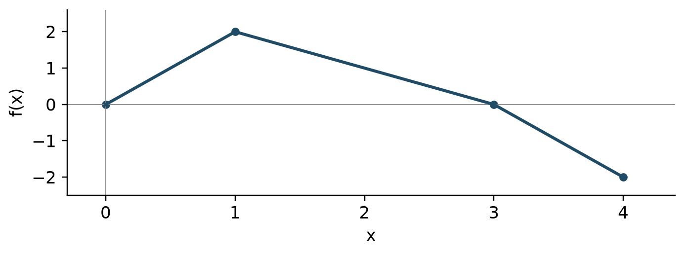
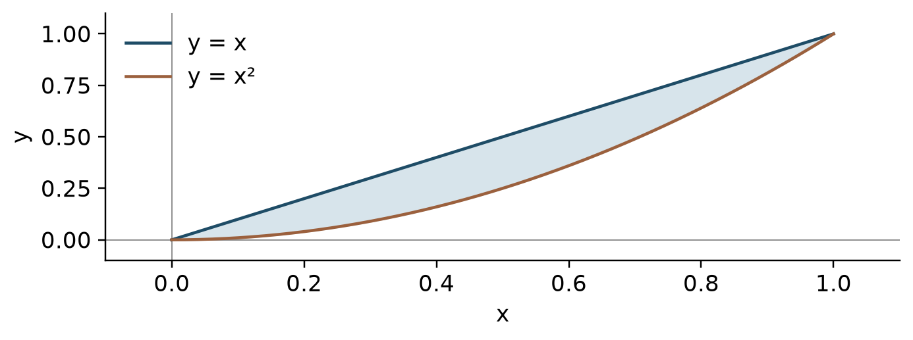
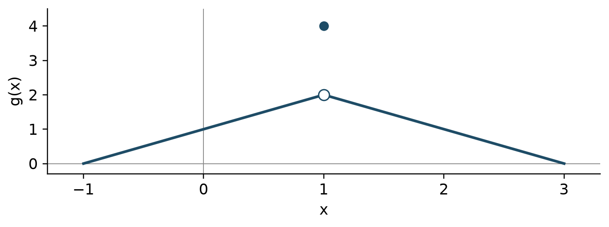
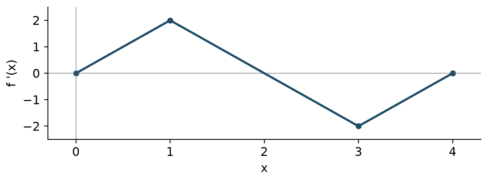

# AP Calculus AB

Original first edition | 2027 preparation | en

## Unit 1 Limits and continuity

Distinguish function values from limits and justify conclusions using continuity and theorem hypotheses.

### Reading approaching values

A limit describes nearby outputs as the input approaches a point. The value at that point may be missing or different. A two-sided finite limit exists only when both one-sided limits agree. Distinguish open and filled points on graphs. A finite table suggests behavior but does not prove a limit.

$$\lim_{x\to a^-}f(x)=\lim_{x\to a^+}f(x)=L$$

### Algebra and the squeeze theorem

Try substitution first. The form $0/0$ calls for further analysis. Factoring and canceling preserve the expression near the point, not necessarily at the point. Conjugates help with radicals. Trigonometric limit identities use radians. The squeeze theorem applies when bounding functions approach the same value.

$$\lim_{x\to0}\frac{\sin x}{x}=1$$

### Continuity and discontinuities

Continuity requires a defined value, an existing limit, and equality of the two. At interval endpoints use the one-sided limit from within the interval. A removable hole can be repaired by redefining a value; jumps and infinite discontinuities cannot. Retain domain restrictions from an original rational denominator.

$$\lim_{x\to a}f(x)=f(a)$$

### Infinity and intermediate values

Infinite limits describe unbounded behavior near vertical asymptotes. Limits at infinity describe end behavior. Compare leading terms of rational functions and check signs. The intermediate value theorem requires continuity on a closed interval and a target between endpoint values. It guarantees existence, not uniqueness.

$$f(a)<N<f(b)\ \Longrightarrow\ f(c)=N\text{ for some }c\in(a,b)$$

### Example

Find $\lim_{x\to4}(x^2-16)/(x-4)$.

For $x\ne4$, factor the numerator as $(x-4)(x+4)$. The nearby expression is $x+4$, so the limit is $8$. The original expression is undefined at $4$, yet its limit exists.

Do not conclude that a zero denominator alone makes the limit nonexistent.

### Example

Explain why $f(x)=x^3+x-5$ has at least one zero in $(1,2)$.

The polynomial is continuous on $[1,2]$. Its endpoint values are $-3$ and $5$, which straddle zero. The intermediate value theorem gives a point $c\in(1,2)$ with $f(c)=0$.

State continuity and endpoint signs, not only the theorem name.

## Unit 2 Derivative definition and basic rules

Define instantaneous rate by a limit and apply basic differentiation rules accurately.

### From average to instantaneous change

A secant slope is an average rate over an interval; a tangent slope is an instantaneous rate. The derivative is the limit of a difference quotient. A centered difference is often useful for estimates from tables, but distinguish an estimate from an exact derivative.

$$f'(a)=\lim_{h\to0}\frac{f(a+h)-f(a)}{h}$$

### Differentiability and continuity

Differentiability implies continuity. A continuous function can still have a corner, cusp, or vertical tangent and fail to have a finite derivative. At a piecewise junction first check continuity, then compare one-sided slopes. A tangent line needs both a function value and a derivative.

$$y=f(a)+f'(a)(x-a)$$

### Basic derivatives

Combine the power, constant-multiple, and sum rules. Use the basic exponential, logarithmic, and trigonometric derivatives. The real domain of $\ln x$ is $x>0$, while the derivative of $\ln|x|$ is $1/x$ for $x\ne0$. Trigonometric derivatives assume radian measure.

$$(e^x)'=e^x,\quad(\sin x)'=\cos x,\quad(\cos x)'=-\sin x$$

### Products and quotients

A product derivative has two terms. A quotient derivative divides by the denominator squared and requires the correct subtraction order. Decide whether expanding or simplifying first is easier. Derivatives of tangent, cotangent, secant, and cosecant follow from sine and cosine ratios.

$$(uv)'=u'v+uv',\qquad\left(\frac{u}{v}\right)'=\frac{u'v-uv'}{v^2}$$

### Example

Use the definition to find $f'(3)$ for $f(x)=x^2$.

The quotient is $((3+h)^2-9)/h=6+h$. Taking $h\to0$ gives $f'(3)=6$. The tangent line is $y-9=6(x-3)$.

Parenthesize the entire numerator of the difference quotient.

### Example

Differentiate $f(x)=x^2e^x$.

The product rule gives $f'(x)=2xe^x+x^2e^x=e^x(x^2+2x)$. Multiplying the two derivatives is not the product rule.

Include both terms in the product rule.

## Unit 3 Composite implicit and inverse derivatives

Read function structure and select chain, implicit, or inverse differentiation.

### Inside and outside

For a composition, evaluate the outer derivative at the inner function and multiply by the inner derivative. With several layers include one derivative from each layer. Combine chain rules with product or quotient rules when needed. Naming the layers before calculating helps prevent omissions.

$$\frac{d}{dx}f(g(x))=f'(g(x))g'(x)$$

### Implicit and higher derivatives

Because $y$ depends on $x$, differentiating a term involving $y$ produces a factor of $y'$. Isolate $y'$ after differentiating. For a second derivative retain that dependence and use the product rule. If a slope formula has zero denominator, examine the original curve and numerator before classifying the tangent.

$$x^2+y^2=r^2\quad\Longrightarrow\quad y'=-\frac{x}{y}\quad(y\ne0)$$

### Slopes of inverse functions

An inverse derivative is the reciprocal of the original derivative at the corresponding original input. Do not confuse an inverse input with an original input. The formula requires a local inverse and a nonzero original derivative. The two graphs reflect across $y=x$.

$$(f^{-1})'(b)=\frac{1}{f'(a)}\quad\text{when }f(a)=b$$

### Inverse trigonometry and notation

Use the derivatives of arcsine and arctangent and include a chain factor for a composition. In this context $\sin^{-1}x$ denotes an inverse function, not $1/\sin x$. A higher derivative comes from differentiating the preceding derivative as a function.

$$(\arcsin x)'=\frac{1}{\sqrt{1-x^2}},\quad(\arctan x)'=\frac{1}{1+x^2}$$

### Example

Differentiate $y=(1+3x^2)^4$.

Differentiate the outer fourth power, then multiply by the inner derivative $6x$. Thus $y'=4(1+3x^2)^3(6x)=24x(1+3x^2)^3$.

Do not omit the inner derivative.

### Example

If $f(2)=7$, $f'(2)=5$, and $g=f^{-1}$, find $g'(7)$.

Since $g(7)=2$, the derivative is $g'(7)=1/f'(2)=1/5$. The value $f'(7)$ is not needed.

Find the corresponding point before taking a reciprocal.

## Unit 4 Contextual applications of differentiation

Interpret derivative units and apply derivatives to motion, related rates, and approximation.

### Units and motion

Derivative units are output units divided by input units. Velocity is the derivative of position and acceleration is the derivative of velocity. Speed is absolute velocity, so a moving particle speeds up when velocity and acceleration have the same sign. Direction and speeding up are separate questions.

$$v(t)=s'(t),\quad a(t)=v'(t),\quad\text{speed}=|v(t)|$$

### Related rates

Draw a diagram and identify quantities that vary with time. Write their relationship, differentiate with respect to time, then substitute values for the specified instant. In conical-tank problems use similar triangles to eliminate a variable first. Track length and volume units through the calculation.

$$V=\frac{4}{3}\pi r^3\quad\Longrightarrow\quad\frac{dV}{dt}=4\pi r^2\frac{dr}{dt}$$

### Linearization

Approximate a nearby function value with a tangent at an easy base point. Linearization is local. If the function is concave down between the base and target points, the tangent overestimates; if concave up, it underestimates. State the relevant concavity condition when judging error direction.

$$f(a+\Delta x)\approx f(a)+f'(a)\Delta x$$

### L Hospital rule

First check for a $0/0$ or infinity-over-infinity form. Under the theorem's differentiability and denominator-derivative conditions, use the limit of the ratio of derivatives. This is different from differentiating the original quotient. Rewrite other indeterminate forms before applying the theorem.

$$\lim\frac{f(x)}{g(x)}=\lim\frac{f'(x)}{g'(x)}\quad\text{when the hypotheses hold}$$

### Example

A sphere has radius $2$ cm and $dr/dt=3$ cm/s. Find its volume rate.

Substitute into $dV/dt=4\pi r^2(dr/dt)$ to obtain $4\pi(2)^2(3)=48\pi$ cm$^3$/s.

Do not replace the changing radius with a constant before differentiating.

### Example

Use linearization to estimate $\sqrt{9.12}$.

Since $f(9)=3$ and $f'(9)=1/6$, the estimate is $3+(1/6)(0.12)=3.02$. The square-root function is concave down, so this is an overestimate.

Multiply the derivative by the input change.

## Unit 5 Analytical applications of differentiation

Use theorem hypotheses and derivative signs to analyze graphs and extrema.

### Mean and extreme values

The mean value theorem needs continuity on a closed interval and differentiability inside; it guarantees an instantaneous rate equal to the average rate. The extreme value theorem guarantees at least one absolute minimum and maximum for a continuous function on a closed bounded interval. Distinguish their hypotheses.

$$f'(c)=\frac{f(b)-f(a)}{b-a}\quad\text{for some }c\in(a,b)$$

### Monotonicity and extrema

A critical number is in the function domain and has zero or undefined derivative. Positive derivative gives increase and negative derivative gives decrease. A change from positive to negative gives a local maximum; the reverse gives a minimum. For absolute extrema compare original function values at critical numbers and endpoints. A zero derivative alone is insufficient.

$$f'(x)>0\Rightarrow f\text{ increases},\qquad f'(x)<0\Rightarrow f\text{ decreases}$$

### Concavity and connected graphs

When $f''>0$, the first derivative increases and the graph is concave up. An inflection point requires a genuine concavity change; $f''=0$ only produces candidates. The second derivative test uses the sign of $f''$ where $f'=0$. If $f''=0$, that test is inconclusive. Do not mistake a derivative graph for a function graph.

$$f'(c)=0,\ f''(c)>0\Rightarrow\text{local minimum at }c$$

### Optimization and implicit analysis

In optimization separate the objective from constraints and identify the feasible domain. Reduce to one variable, then compare critical values with endpoints or boundary behavior. For implicit curves use $y'$ and $y''$ to analyze tangents and concavity. Check that results meet the original length, time, or quantity restrictions.

$$A(x)=x(P-2x)\quad\text{for a three-sided enclosure of fence length }P$$

### Example

Find absolute extrema of $f(x)=x^3-3x$ on $[-2,2]$.

Critical numbers are $-1$ and $1$. Values at endpoints and critical numbers are $-2,2,-2,2$, respectively. The absolute maximum is $2$ and minimum is $-2$, each attained twice.

Include endpoints and all locations attaining a tied extreme value.

### Example

A river forms one side of a rectangle; $48$ m of fence covers the other three. Find the maximum area.

Let the perpendicular side be $x$. The other side is $48-2x$, with $0<x<24$. Setting $A'=48-4x=0$ gives sides $12$ and $24$. The concave-down quadratic has maximum area $288$ m$^2$.

Do not count the river side as fenced.

## Unit 6 Integration and accumulation of change

Interpret a definite integral as signed accumulation and use the fundamental theorem and substitution.

### Riemann sums and numerical integration

Partition the interval and add width times representative height. Left, right, and midpoint sums differ in their sample points. Trapezoids average endpoint heights. With unequal widths multiply each width separately. A definite integral gives signed area, so regions below the axis contribute negatively.

$$\int_a^b f(x)\,dx=\lim_{n\to\infty}\sum_{i=1}^{n} f(a+i\Delta x)\Delta x$$

### Accumulation and the fundamental theorem

For a continuous integrand, differentiating accumulation from a fixed lower endpoint to a variable upper endpoint returns the integrand. Include a chain factor for a composed upper endpoint. If both endpoints vary, write a difference of accumulations. Integrand signs control accumulation's increase and integrand slopes control its concavity.

$$\frac{d}{dx}\int_a^{g(x)}f(t)\,dt=f(g(x))g'(x)$$

### Antiderivatives and integral properties

An antiderivative differentiates to the integrand; include $C$ for an indefinite integral. A definite integral equals an antiderivative's endpoint difference. Reversing bounds changes the sign, and adjacent intervals add. Odd and even symmetry can simplify symmetric intervals. Check an antiderivative by differentiating it.

$$\int_a^b f(x)\,dx=F(b)-F(a)\quad\text{when }F'=f$$

### Substitution and algebraic preparation

Try substitution when an inner expression appears with its derivative. For definite integrals change the bounds or return to the original variable before evaluating. Polynomial division and completing the square can reveal basic forms. Recognize arctangent and arcsine patterns. Integration by parts, partial fractions, and improper integrals are reserved for the BC extension.

$$\int f(g(x))g'(x)\,dx=F(g(x))+C$$

### Example

Evaluate $\int_0^1 2x(x^2+1)^3\,dx$.

Set $u=x^2+1$ and $du=2x\,dx$; the new bounds are $1$ and $2$. Then $\int_1^2u^3\,du=[u^4/4]_1^2=15/4$.

Do not mix transformed variables with original bounds.

### Example

If $F(x)=\int_1^{x^2}\cos t\,dt$, find $F'(x)$.

Evaluate the integrand at the upper endpoint and multiply by its derivative: $F'(x)=2x\cos(x^2)$.

Do not omit the upper-endpoint derivative $2x$.

## Unit 7 Differential equations

Interpret slope fields and use separation with initial conditions.

### Equations and slope fields

A differential equation relates a function to its rate of change. Each slope-field segment gives the derivative at its $(x,y)$ location. If the rate depends only on $y$, slopes agree along horizontal rows; if only on $x$, along vertical columns. An equation may have infinitely many solutions.

$$\frac{dy}{dx}=F(x,y)$$

### Verification and equilibrium

Verify a candidate by substituting both the function and its derivative into the original equation, then check the initial condition separately. An equilibrium solution is constant. When dividing by a factor during separation, check whether zero values of that factor yield equilibrium solutions that would otherwise be lost.

$$y'=k(y-M)\quad\Longrightarrow\quad y=M\text{ is an equilibrium}$$

### Separation and initial values

For $dy/dx=g(x)h(y)$, separate as $dy/h(y)=g(x)dx$ on an interval where division is valid. Integrate and determine the constant from the initial condition. When solving with logarithms or square roots retain the appropriate branch and domain. Differentiate the result to check the equation and initial value.

$$\int\frac{1}{h(y)}\,dy=\int g(x)\,dx$$

### Exponential models and cooling

A rate proportional to the quantity produces an exponential model. If the rate is proportional to the difference from a baseline, model that difference first. Find half-lives or doubling times by substituting into the exponential equation. Euler's method and detailed logistic modeling belong to the later BC extension.

$$y'=k(y-M)\quad\Longrightarrow\quad y=M+Ce^{kx}$$

### Example

Solve $y'=2xy$ with $y(0)=3$.

Separate to get $\ln|y|=x^2+C$, hence $y=Ae^{x^2}$. The initial condition gives $A=3$. Differentiating $3e^{x^2}$ returns $2xy$.

Determine the integration constant from the initial value.

### Example

Solve $T'=-0.2(T-20)$ with $T(0)=70$.

The excess temperature is $T-20=Ce^{-0.2t}$. The initial condition gives $C=50$, so $T=20+50e^{-0.2t}$, approaching $20$ over time.

Exponentially decay the excess temperature, not the entire initial temperature.

## Unit 8 Applications of integration

Use integration for averages, accumulated quantities, area, and volume with appropriate units.

### Average values and accumulated quantities

A function's average value is its integral divided by interval length; it is not average rate of change. Final amount equals initial amount plus net change. Integrate inflow minus outflow when both occur. To maximize an amount compare times when the net rate is zero with interval endpoints.

$$f_{\mathrm{avg}}=\frac{1}{b-a}\int_a^b f(x)\,dx$$

### Displacement and distance

Integrating velocity gives displacement; integrating absolute velocity gives total distance. Find velocity zeros and split intervals when the sign changes. Add the initial position to recover position. Zero displacement can coexist with positive distance traveled.

$$\Delta s=\int_a^b v(t)\,dt,\qquad D=\int_a^b|v(t)|\,dt$$

### Areas between curves

For vertical slices integrate top minus bottom with respect to $x$; for horizontal slices integrate right minus left with respect to $y$. Find all intersections and split where ordering changes. Distinguish signed integrals from geometric area. Check that the diagram and integral describe the same region.

$$A=\int_a^b(\text{top}-\text{bottom})\,dx$$

### Cross sections and solids of revolution

Volume is the integral of cross-sectional area. A square has area side squared, an equilateral triangle has area $\sqrt3/4$ times side squared, and a semicircle with diameter $d$ has area $\pi d^2/8$. Disk and washer radii are distances from the rotation axis. Redefine these distances for shifted horizontal or vertical axes.

$$V=\int_a^b A(x)\,dx,\qquad V=\pi\int_a^b(R^2-r^2)\,dx$$

### Example

For $v(t)=t-2$ on $0\le t\le4$, find displacement and total distance.

Displacement is $\int_0^4(t-2)\,dt=0$. Split at $t=2$: distance is $-\int_0^2(t-2)\,dt+\int_2^4(t-2)\,dt=4$.

Opposite directions do not cancel in total distance.

### Example

Rotate the region between $y=x$ and $y=x^2$, $0\le x\le1$, about the $x$-axis. Find its volume.

The outer radius is $x$ and inner radius is $x^2$, so $V=\pi\int_0^1(x^2-x^4)\,dx=2\pi/15$.

Integrate the difference of squares, not the square of a difference.

## Assessment questions

### D01

What is the larger root of $x^2-5x+6=0$?

- A. $3$
- B. $6$
- C. $2$
- D. $5$

### D02

For $x\ne4$, simplify $(x^2-16)/(x-4)$.

- A. $x + 4$
- B. $x^{2} + 4$
- C. $x - 4$
- D. $4$

### D03

Find $\sin(\pi/6)$.

- A. $0$
- B. $\frac{1}{2}$
- C. $\frac{\sqrt{3}}{2}$
- D. $1$

### D04

Find $\ln(e^3)$.

- A. $0$
- B. $3$
- C. $e^{3}$
- D. $1$

### D05

If $f(x)=x^2+1$ and $g(x)=2x-3$, find $f(g(2))$.

- A. $7$
- B. $10$
- C. $1$
- D. $2$

### D06

Find the slope through $(1,3)$ and $(5,11)$.

- A. $2$
- B. $\frac{1}{2}$
- C. $8$
- D. $4$

### D07

What is the real domain of $\ln(x-2)$?

- A. $x\ge2$
- B. All real numbers
- C.  $x>2$
- D. $x<2$

### D08

For $f(x)=3x+5$, find $f^{-1}(11)$.

- A. $2$
- B. $\frac{16}{3}$
- C. $38$
- D. $\frac{1}{11}$

### D09

For $x>0$, simplify $x^{3/2}/x^{1/2}$.

- A. $x$
- B. $\sqrt{x}$
- C. $1$
- D. $x^{2}$

### D10

What is $\sin^2x+\cos^2x$?

- A. $1$
- B. $\sin{\left(2 x \right)}$
- C. $2$
- D. $0$

### D11

Find the minimum of $x^2-6x+11$.

- A. $11$
- B. $3$
- C. $2$
- D. $-6$

### D12

Find the sum of the two solutions of $|x-2|=5$.

- A. $10$
- B. $-3$
- C. $4$
- D. $7$

### U1-M01

Evaluate $\lim_{x\to3}(x^2-9)/(x-3)$.

- A. $3$
- B. $0$
- C. $6$
- D. $9$

### U1-M02

Let $f(x)=2+x$ for $x<0$ and $f(x)=5-x$ for $x\ge0$. What is the two-sided limit at $0$?

- A. $5$
- B. $7/2$
- C. Does not exist
- D. $2$

### U1-M03

For $x<2$, $f(x)=kx+1$; for $x\ge2$, $f(x)=x^2+5$. Which $k$ makes $f$ continuous?

- A. $4$
- B. $9$
- C. $2$
- D. $5$

### U1-M04

Evaluate $\lim_{x\to0}x^2\sin(1/x)$.

- A. $2$
- B. $1$
- C. $0$
- D. $-1$

### U1-M05

Evaluate $\lim_{x\to\infty}(3x^2-x)/(2x^2+7)$.

- A. $\frac{2}{3}$
- B. $3$
- C. $0$
- D. $\frac{3}{2}$

### U1-M06

A continuous $f$ on $[0,4]$ satisfies $f(0)=-2$ and $f(4)=6$. Which must be true?

- A. There is $c\in(0,4)$ with $f(c)=1$
- B. There is exactly one zero
- C. $f$ is increasing
- D. $f(2)=2$

### U2-M01

Evaluate $\lim_{h\to0}((2+h)^3-8)/h$.

- A. $4$
- B. $12$
- C. $6$
- D. $8$

### U2-M02

If $f(x)=x^2\sin x$, find $f\prime(\pi/2)$.

- A. $0$
- B. $2$
- C. $\pi$
- D. $\frac{\pi^{2}}{4}$

### U2-M03

For $f(x)=(x^2+1)/(x+1)$, find $f\prime(1)$.

- A. $1$
- B. $\frac{1}{2}$
- C. $2$
- D. $0$

### U2-M04

For $f(x)=\tan x$, find $f\prime(\pi/4)$.

- A. $\sqrt{2}$
- B. $1$
- C. $2$
- D. $0$

### U2-M05

Which describes $f(x)=|x-2|$ at $x=2$?

- A. Continuous but not differentiable
- B. Its derivative is $0$
- C. Continuous and differentiable
- D. Discontinuous

### U2-M06

The values of $f$ at $x=1.8,2,2.2$ are $4.1,4.8,5.7$. Estimate $f\prime(2)$ using the outer two points.

- A. $4$
- B. $0.8$
- C. $8$
- D. $2$

### U3-M01

If $f(x)=(2x^3+1)^4$, find $f\prime(1)$.

- A. $108$
- B. $648$
- C. $216$
- D. $72$

### U3-M02

On $x^2+xy+y^2=7$, find $dy/dx$ at $(1,2)$.

- A. $- \frac{5}{4}$
- B. $- \frac{1}{2}$
- C. $\frac{4}{5}$
- D. $- \frac{4}{5}$

### U3-M03

If $f(3)=8$, $f\prime(3)=4$, and $g$ is its local inverse, find $g\prime(8)$.

- A. $3$
- B. $4$
- C. $\frac{1}{4}$
- D. $\frac{1}{8}$

### U3-M04

For $f(x)=\arctan(3x)$, find $f\prime(0)$.

- A. $3$
- B. $\frac{1}{3}$
- C. $0$
- D. $1$

### U3-M05

For $f(x)=\sin(2x)$, find $f^{\prime\prime}(\pi/4)$.

- A. $-2$
- B. $4$
- C. $0$
- D. $-4$

### U3-M06

Let $g$ be the inverse of $f(x)=\ln x$. Find $g\prime(\ln5)$.

- A. $5$
- B. $\frac{1}{5}$
- C. $\log{\left(5 \right)}$
- D. $1$

### U4-M01

A particle has velocity $v(t)=3t^2-12t+9$. At $t=3/2$ it is:

- A. Moving in the negative direction and slowing down
- B. At rest
- C. Moving in the positive direction and speeding up
- D. Moving in the negative direction and speeding up

### U4-M02

When a sphere has radius $3$ cm, $dr/dt=2$ cm/s. Find $dV/dt$ in cm$^3$/s.

- A. $18 \pi$
- B. $24 \pi$
- C. $36 \pi$
- D. $72 \pi$

### U4-M03

Use linearization at $x=16$ to estimate $\sqrt{16.2}$.

- A. $4$
- B. $\frac{41}{10}$
- C. $\frac{161}{40}$
- D. $\frac{81}{20}$

### U4-M04

Evaluate $\lim_{x\to0}(e^{2x}-1)/x$.

- A. $1$
- B. $0$
- C. $4$
- D. $2$

### U4-M05

$W(t)$ is water volume in liters and $t$ is hours. Interpret $W\prime(3)=-4$.

- A. The rate itself decreases by $4$ liters per hour each hour
- B. At hour $3$, water volume decreases at $4$ liters per hour
- C. Volume fell by $4$ liters over the first $3$ hours
- D. There are $4$ liters at hour $3$

### U4-M06

A $10$ m ladder has its foot $6$ m from a wall, moving outward at $2$ m/s. Find the top height rate in m/s.

- A. $\frac{3}{2}$
- B. $-2$
- C. $- \frac{8}{3}$
- D. $- \frac{3}{2}$

### U5-M01

For $f(x)=x^2$ on $[1,5]$, find the mean-value-theorem point $c$.

- A. $4$
- B. $2$
- C. $3$
- D. $6$

### U5-M02

Find the absolute maximum value of $f(x)=x^3-3x$ on $[-2,2]$.

- A. $-2$
- B. $0$
- C. $2$
- D. $6$

### U5-M03

Which describes $x=0$ for $f(x)=x^3$?

- A. A local minimum
- B. Not a critical number
- C. An inflection point but no local extremum
- D. A local maximum

### U5-M04

If $f\prime(x)=(x-1)(x-3)$, where is $f$ increasing?

- A. $(1,3)$
- B.  $(-\infty,1)$ and $(3,\infty)$
- C. All real numbers
- D. $(-\infty,3)$

### U5-M05

If $f^{\prime\prime}(x)=6x-12$ everywhere, find the inflection input.

- A. $6$
- B. $2$
- C. $12$
- D. $0$

### U5-M06

What is the maximum area in m$^2$ of a rectangle with perimeter $40$ m?

- A. $80$
- B. $200$
- C. $400$
- D. $100$

### U6-M01

Evaluate $\int_0^2(3x^2+1)\,dx$.

- A. $14$
- B. $8$
- C. $6$
- D. $10$

### U6-M02

If $F(x)=\int_0^{x^2}\sqrt{1+t}\,dt$, find $F\prime(2)$.

- A. $4 \sqrt{5}$
- B. $2 \sqrt{5}$
- C. $4 \sqrt{3}$
- D. $\sqrt{5}$

### U6-M03

At $t=0,1,3$, the values of $r(t)$ are $2,4,8$. Estimate $\int_0^3r(t)\,dt$ with two trapezoids.

- A. $14$
- B. $18$
- C. $12$
- D. $15$

### U6-M04

Evaluate $\int_0^1 6x(1+3x^2)^2\,dx$.

- A. $63$
- B. $7$
- C. $21$
- D. $16$

### U6-M05

For $x>0$, which is an antiderivative of $(x^2+1)/x$?

- A. $2 x - \frac{1}{x^{2}}$
- B. $\log{\left(x^{2} + 1 \right)}$
- C. $x^{2} + \log{\left(x \right)}$
- D. $\frac{x^{2}}{2} + \log{\left(x \right)}$

### U6-M06

The graph of $f$ consists of line segments. If $F(x)=\int_0^x f(t)\,dt$, find $F(3)$.

- A. $6$
- B. $4$
- C. $3$
- D. $2$

### U7-M01

If $y\prime=3y$ and $y(0)=2$, find $y(\ln2)$.

- A. $8$
- B. $16$
- C. $4$
- D. $6$

### U7-M02

For $y\prime=x-y$, what is the slope at $(1,3)$?

- A. $-2$
- B. $-4$
- C. $4$
- D. $2$

### U7-M03

For $y\prime=x/y$ with $y(0)=2$, find $y(1)$.

- A. $\sqrt{3}$
- B. $- \sqrt{5}$
- C. $5$
- D. $\sqrt{5}$

### U7-M04

Find the equilibrium solution of $y\prime=-2(y-7)$.

- A. $-7$
- B. $7$
- C. $0$
- D. $2$

### U7-M05

Which equation is satisfied by $y=Ce^{-2x}$ for every constant $C$?

- A. $y\prime=y^2$
- B. $y\prime=2y$
- C. $y\prime=-2y$
- D. $y\prime=-2x$

### U7-M06

If $T\prime=-\tfrac12(T-20)$ and $T(0)=60$, find $T(2)$.

- A. $\frac{40}{e} + 20$
- B. $\frac{40}{e}$
- C. $20 + \frac{60}{e}$
- D. $\frac{60}{e}$

### U8-M01

Find the average value of $f(x)=x^2$ on $[0,3]$.

- A. $9$
- B. $6$
- C. $\frac{9}{2}$
- D. $3$

### U8-M02

A particle has $v(t)=t-1$ m/s for $0\le t\le3$. Find total distance in meters.

- A. $\frac{3}{2}$
- B. $3$
- C. $2$
- D. $\frac{5}{2}$

### U8-M03

Find the area between $y=x$ and $y=x^2$ on $0\le x\le1$.

- A. $\frac{2}{3}$
- B. $\frac{1}{3}$
- C. $\frac{1}{6}$
- D. $\frac{1}{2}$

### U8-M04

Rotate the region bounded by $y=\sqrt x$, the $x$-axis, and $x=4$ about the $x$-axis. Find the volume.

- A. $4 \pi$
- B. $\frac{32 \pi}{3}$
- C. $8 \pi$
- D. $16 \pi$

### U8-M05

A solid has base between $y=x$ and $y=x^2$. Cross sections perpendicular to the $x$-axis are squares. Find its volume.

- A. $\frac{1}{15}$
- B. $\frac{1}{30}$
- C. $\frac{1}{6}$
- D. $\frac{\pi}{30}$

### U8-M06

Find the area enclosed by $x=y^2$ and $x=2y$.

- A. $\frac{8}{3}$
- B. $4$
- C. $\frac{4}{3}$
- D. $\frac{2}{3}$

### U1-F01

Define $f(x)=x^2+a$ for $x<1$, $f(1)=b$, and $f(x)=3x-1$ for $x>1$.

(a) Find the left and right limits at $1$.
(b) Find $a,b$ that make $f$ continuous everywhere.
(c) Use part (b). Justify the existence of $c\in(0,2)$ with $f(c)=3$, and find one such value.

### U1-F02

The graph follows segments from $(-1,0)$ to $(1,2)$ to $(3,0)$, with a hole at $(1,2)$ and actual value $g(1)=4$.

(a) Find the two-sided limit and the function value at $1$.
(b) Redefine one value to make $g$ continuous at $1$.
(c) For the original function, $g(0)=1$ and $g(1)=4$. Can IVT guarantee the value $3$ on $[0,1]$? Does such a point actually exist?

### U2-F01

Let $f(x)=x^3-2x$.

(a) Expand the difference quotient to find $f\prime(-1)$ from the definition.
(b) Find the tangent line at $x=-1$.
(c) Find $f^{\prime\prime}(-1)$ and explain whether it is the tangent slope.

### U2-F02

$P(t)$ is plant height in centimeters, where $t$ is weeks. Assume $P$ is differentiable and use the table.

| t | P(t) |
| --- | --- |
| 0 | 2 |
| 1 | 3.5 |
| 2 | 6 |
| 3 | 10 |

(a) Use $t=1,3$ to estimate $P\prime(2)$ and give units.
(b) Find the average height rate on $[0,3]$.
(c) Use the estimated slope in (a) to approximate $P(2.2)$.

### U3-F01

Consider the point $(3,4)$ on $x^2+y^2=25$.

(a) Find $dy/dx$ in terms of $x,y$ and evaluate it at the point.
(b) Find the tangent line at the point.
(c) Find $d^2y/dx^2$ at the point.

### U3-F02

Let $f(x)=x^3+x$ and $g=f^{-1}$.

(a) Explain why the inverse exists and find $g(10)$.
(b) Find $g\prime(10)$.
(c) If $H(x)=g(5x)$, find $H\prime(2)$.

### U4-F01

A particle has position $s(t)=t^3-6t^2+9t$ meters for $0\le t\le4$, with time in seconds.

(a) Find formulas for velocity and acceleration.
(b) At $t=1.5$, justify the direction and whether the particle is speeding up.
(c) Use linearization at $1.5$ to estimate $s(1.6)$.

### U4-F02

An inverted cone has height $8$ cm and top radius $4$ cm. Water enters at $3\pi$ cm$^3$/s. At a certain instant its water depth is $2$ cm.

(a) Express water volume using only depth $h$.
(b) Find $dh/dt$ at that instant.
(c) Linearly estimate the depth $0.1$ second later. Justify whether it overestimates the actual depth.

### U5-F01

Analyze $f(x)=x^3-6x^2+9x+1$ on $[0,4]$.

(a) Justify intervals of increase and decrease and locate interior local extrema.
(b) Find absolute extreme values and every location attaining them.
(c) Find the inflection point and explain the concavity change.

### U5-F02

Cut squares of side $x$ cm from each corner of an $18$ cm square sheet and fold an open-top box.

(a) Write the volume function and physically feasible domain.
(b) Justify the maximizing cut size and find the maximum volume.
(c) If equipment restricts cuts to $0<x\le2$, what is the maximum volume?

### U6-F01

The graph shows $f$. Define $F(x)=1+\int_0^x f(t)\,dt$ on $0\le x\le4$.

(a) Find $F(3)$ and $F(4)$.
(b) Find $F\prime(2)$ and $F^{\prime\prime}(2)$.
(c) Justify the absolute maximum of $F$ and its location.

### U6-F02

$r(t)$ is inflow in liters per minute. Initially a tank contains $20$ liters. Assume $r$ is continuous and water only enters.

| t | r(t) |
| --- | --- |
| 0 | 3 |
| 2 | 5 |
| 5 | 4 |
| 6 | 7 |

(a) Estimate $\int_0^6r(t)\,dt$ with a left Riemann sum on the three tabulated intervals.
(b) Use trapezoids over the same intervals.
(c) Use (b) to estimate volume at $6$ and average inflow on $[0,6]$.

### U7-F01

Consider $y\prime=x(y-1)$ with $y(0)=3$.

(a) Describe where the slope field has zero slope and find the initial tangent slope.
(b) Solve the initial-value problem.
(c) Determine the solution concavity on the real line.

### U7-F02

Temperature satisfies $T\prime=-k(T-18)$ with $k>0$, $T(0)=82$, and $T(10)=50$. Time is in minutes and temperature in degrees Celsius.

(a) Express $T$ in terms of $k,t$.
(b) Find the exact value of $k$.
(c) Find the time when temperature reaches $26$.

### U8-F01

A particle has $v(t)=(t-1)(t-3)$ m/s, $s(0)=2$ meters, and $0\le t\le4$.

(a) Find $s(4)$.
(b) Find total distance traveled.
(c) Find the absolute maximum position and all times attaining it.

### U8-F02

Let $R$ be the bounded region between $y=x$ and $y=x^2$.

(a) Find the intersection inputs and area.
(b) Find the volume when $R$ revolves about the $x$-axis.
(c) Find the volume when $R$ revolves about $y=2$.

### E01

Evaluate $\lim_{x\to4}(\sqrt{x+5}-3)/(x-4)$.

- A. $\frac{1}{3}$
- B. $\frac{1}{6}$
- C. $0$
- D. $3$

### E02

For $f(x)=e^x+x^{-2}$, find $f\prime(1)$.

- A. $e$
- B. $-2 + e$
- C. $-1 + e$
- D. $2 + e$

### E03

Find the tangent slope at $(1,2)$ on $xy+y^2=6$.

- A. $- \frac{2}{5}$
- B. $- \frac{5}{2}$
- C. $- \frac{1}{2}$
- D. $\frac{2}{5}$

### E04

$T(t)$ is degrees Celsius and $t$ is minutes. What does $T\prime(5)=3.2$ mean?

- A. It rose $3.2$ degrees over five minutes
- B. The temperature rate increases by $3.2$ each minute
- C. The temperature at minute $5$ is $3.2$ degrees
- D. At minute $5$, temperature rises at $3.2$ degrees per minute

### E05

For $f(x)=\ln x$ on $[1,e^2]$, find the MVT point $c$.

- A. $\frac{2}{-1 + e^{2}}$
- B. $\frac{1}{2} + \frac{e^{2}}{2}$
- C. $e$
- D. $- \frac{1}{2} + \frac{e^{2}}{2}$

### E06

Evaluate $\int_{-1}^1(3x^2+2x)\,dx$.

- A. $4$
- B. $0$
- C. $2$
- D. $6$

### E07

If $y\prime=2y$ and $y(0)=5$, find $y(1)$.

- A. $7$
- B. $5 e^{2}$
- C. $10$
- D. $5 e$

### E08

Find the area bounded by $y=2x-x^2$ and the $x$-axis.

- A. $\frac{2}{3}$
- B. $\frac{8}{3}$
- C. $2$
- D. $\frac{4}{3}$

### E09

Evaluate $\lim_{x\to2}1/(x-2)^2$.

- A. $0$
- B. $\infty$
- C. $-\infty$
- D. $1$

### E10

At $x=1,2,3$, $f(x)=5,8,15$. Estimate $f\prime(2)$ using $x=1,3$.

- A. $10$
- B. $3$
- C. $5$
- D. $7$

### E11

For $f(x)=\arcsin(x/2)$, find $f\prime(1)$.

- A. $\frac{2 \sqrt{3}}{3}$
- B. $\sqrt{3}$
- C. $\frac{1}{2}$
- D. $\frac{\sqrt{3}}{3}$

### E12

Evaluate $\lim_{x\to0}\ln(1+3x)/\sin(2x)$.

- A. $3$
- B. $0$
- C. $\frac{3}{2}$
- D. $\frac{2}{3}$

### E13

The graph shows $f\prime$. On which open intervals is $f$ concave up?

- A. $(1,3)$
- B. $(0,2)$
- C. $(2,4)$
- D. $(0,1)$ and $(3,4)$

### E14

Evaluate $\lim_{n\to\infty}\sum_{i=1}^n(2/n)(1+2i/n)^2$.

- A. $9$
- B. $\frac{8}{3}$
- C. $\frac{26}{3}$
- D. $\frac{13}{3}$

### E15

When separating $y\prime=x(y+4)$, one divides by $y+4$. Which constant solution must be checked separately?

- A. $0$
- B. $-4$
- C. $- x$
- D. $4$

### E16

Find the average value of $\sin x$ on $[0,\pi]$.

- A. $1$
- B. $2$
- C. $\frac{\pi}{2}$
- D. $\frac{2}{\pi}$

### E17

Which correctly justifies a zero of $p(x)=x^3+2x-1$ in $(0,1)$?

- A. Continuity and $p(0)=-1<0<2=p(1)$ allow IVT
- B. Because $p(0)+p(1)>0$
- C. Opposite endpoint signs suffice without continuity
- D. Every cubic has a zero in $(0,1)$

### E18

For $f(x)=x\sin x$, find $f\prime(\pi)$.

- A. $\pi$
- B. $-1$
- C. $0$
- D. $- \pi$

### E19

Water depth rises at $3$ m/min in a cylinder of fixed radius $2$ m. Find the volume rate in m$^3$/min.

- A. $24 \pi$
- B. $12 \pi$
- C. $4 \pi$
- D. $6 \pi$

### E20

Find the absolute minimum of $f(x)=x^4-4x^2$ on $[-2,2]$.

- A. $-4$
- B. $4$
- C. $0$
- D. $-8$

### E21

Evaluate $\int_0^1 1/(1+x^2)\,dx$.

- A. $\frac{\pi}{4}$
- B. $\frac{1}{2}$
- C. $\frac{\pi}{2}$
- D. $\log{\left(2 \right)}$

### E22

Rotate the region bounded by $x=\sqrt y$, the $y$-axis, and $y=4$ about the $y$-axis. Find the volume.

- A. $8 \pi$
- B. $16 \pi$
- C. $\frac{32 \pi}{3}$
- D. $4 \pi$

### E23

Evaluate $\lim_{x\to0}\sin(5x)/(3x)$.

- A. $\frac{3}{5}$
- B. $1$
- C. $\frac{5}{3}$
- D. $0$

### E24

Let $f(x)=ax+b$ for $x<1$ and $f(x)=x^2$ for $x\ge1$. If $f$ is differentiable at $1$, find $b$.

- A. $1$
- B. $0$
- C. $2$
- D. $-1$

### E25

What is the concavity of $y=\sqrt{9-x^2}$ on $-3<x<3$?

- A. Concave up throughout
- B. Concavity changes at zero
- C. Linear
- D. Concave down throughout

### E26

Which is an antiderivative of $1/(x^2-2x+5)$?

- A. $\operatorname{atan}{\left(x - 1 \right)}$
- B. $\log{\left(x^{2} - 2 x + 5 \right)}$
- C. $2 \operatorname{atan}{\left(\frac{x}{2} - \frac{1}{2} \right)}$
- D. $\frac{\operatorname{atan}{\left(\frac{x}{2} - \frac{1}{2} \right)}}{2}$

### E27

Cross sections are semicircles of diameter $2-x$ for $0\le x\le2$. Find the volume.

- A. $\frac{4 \pi}{3}$
- B. $\frac{2 \pi}{3}$
- C. $\frac{\pi}{3}$
- D. $\frac{8}{3}$

### E28

If $f\prime(x)=x^2(x+1)$, which statement about local extrema is correct?

- A. A local minimum at $-1$ and no extremum at $0$
- B. There is a maximum at $-1$
- C. Both points are minima
- D. Only $0$ is a maximum

### E29

If $F(x)=\int_x^{2x}\cos(t^2)\,dt$, find $F\prime(0)$.

- A. $0$
- B. $1$
- C. $2$
- D. $-1$

### E30

Find the zero of $p(x)=x^3+x-4$ in $[1,2]$ to three decimal places.

- A. $1.812$
- B. $1.379$
- C. $1.587$
- D. $1.213$

### E31

For $f(x)=x^2e^x$, find $f\prime(0.7)$.

- A. $0.987$
- B. $3.806$
- C. $1.904$
- D. $2.819$

### E32

Let $f(x)=x+e^x$ and $g=f^{-1}$. If $b=1.2+e^{1.2}$, find $g\prime(b)$.

- A. $0.432$
- B. $0.231$
- C. $4.32$
- D. $0.301$

### E33

If $v(t)=\sin(t^2)+0.2t$ m/s, find acceleration at $t=1.4$ in m/s$^2$.

- A. $0.862$
- B. $-0.862$
- C. $-0.379$
- D. $1.205$

### E34

Where does $f(x)=x^2+e^{-x}$ attain its absolute minimum on $[0,2]$?

- A. $0.693$
- B. $1.0$
- C. $1.256$
- D. $0.352$

### E35

Find the absolute maximum value of $f(x)=2\sin x-x^2/2$ on $[0,\pi]$.

- A. $1.03$
- B. $2.0$
- C. $0.816$
- D. $1.184$

### E36

Evaluate $\int_0^1e^{-x^2}\,dx$ numerically.

- A. $0.842$
- B. $0.632$
- C. $1.128$
- D. $0.747$

### E37

For $F(x)=\int_0^{\ln x}e^{-t^2}\,dt$, find $F\prime(2)$.

- A. $0.24$
- B. $0.309$
- C. $0.619$
- D. $0.347$

### E38

Use three trapezoids from the table to estimate $\int_0^2f(x)\,dx$.

| x | f(x) |
| --- | --- |
| 0 | 1 |
| 0.5 | 1.6 |
| 1.5 | 2.1 |
| 2 | 2.4 |

- A. $3.45$
- B. $4.1$
- C. $3.8$
- D. $3.625$

### E39

If $y\prime=0.4(10-y)$ and $y(0)=2$, when does $y$ first reach $8$?

- A. $3.466$
- B. $1.733$
- C. $2.5$
- D. $5.198$

### E40

Find the area enclosed by $y=e^{-x}$, $y=x/2$, and the $y$-axis.

- A. $0.574$
- B. $0.853$
- C. $0.608$
- D. $0.392$

### E41

For $v(t)=\cos t-0.2$ m/s, find total distance on $[0,4]$ in meters.

- A. $3.517$
- B. $2.969$
- C. $0.757$
- D. $1.557$

### E42

If $T(t)=20+80e^{-0.3t}$, find $T\prime(4)$.

- A. $44.096$
- B. $-7.229$
- C. $-24.096$
- D. $7.229$

### EF01

A tank initially contains $40$ liters. For $0\le t\le4$ minutes, inflow is $R(t)=12+3\sin(t^2/4)$ L/min and outflow is $D(t)=8+t$ L/min.

(a) Find the volume at $t=4$ to three decimal places.
(b) Justify the time when water volume is greatest on $[0,4]$.
(c) At $t=2$, is the water-volume rate increasing? Justify.

### EF02

Let $f(x)=e^{-x^2}+x/4$ and $F(x)=\int_0^x f(t)\,dt$ for $0\le x\le2$.

(a) Find $F(2)$ and the average value of $f$ on the interval.
(b) Find the absolute maximum value of $f$ and show candidate comparisons.
(c) Justify whether $F$ increases throughout the interval.

### EF03

The graph shows a continuous $f$ and $G(x)=\int_0^x f(t)\,dt$ on $[0,4]$.

(a) Find $G(4)$ and $G\prime(2)$.
(b) Justify the absolute maximum of $G$ and its location.
(c) Find all inflection inputs of $G$ and explain why $x=1$ is included.

### EF04

Consider $y\prime=2x(y+2)$ with $y(0)=1$.

(a) Find the initial tangent line and use it to estimate $y(0.1)$.
(b) Find an explicit solution by separation.
(c) Use the second derivative to decide whether the estimate in (a) is high or low.

### EF05

Let $R$ be the region bounded by $y=4-x^2$ and the $x$-axis.

(a) Find the area of $R$.
(b) Find the volume when $R$ revolves about the $x$-axis.
(c) A different solid has base $R$ and equilateral-triangle cross sections perpendicular to the $x$-axis. Find its volume.

### EF06

Let $f(x)=ax+b$ for $x<1$ and $f(x)=x^2+1$ for $x\ge1$. Choose parameters so that $f$ is differentiable at $1$.

(a) Find $a,b$ and state both matching conditions.
(b) Justify MVT on $[0,2]$ and find a point $c\in(0,2)$ satisfying it.
(c) Find the average value of $f$ on $[0,2]$.
