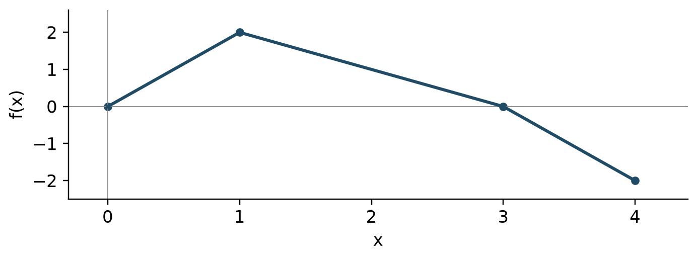
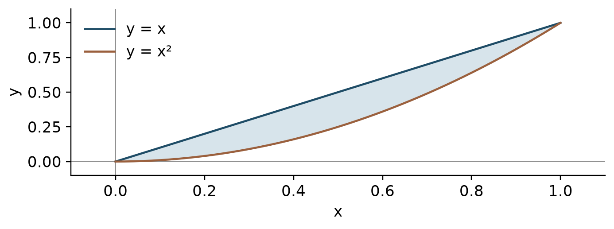
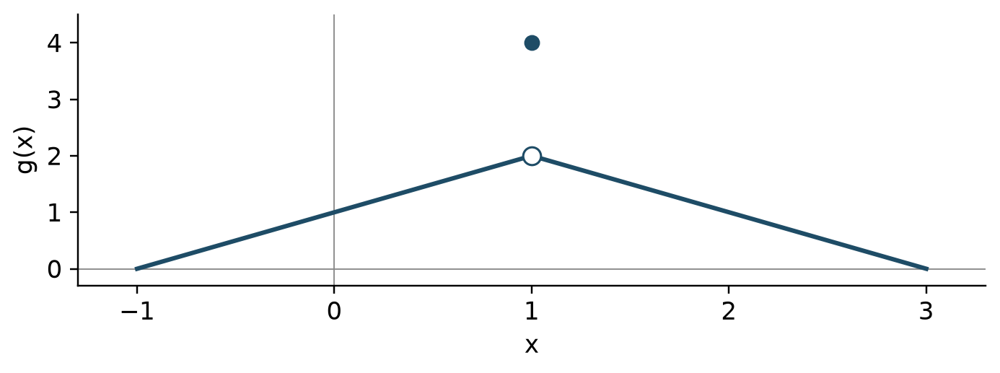
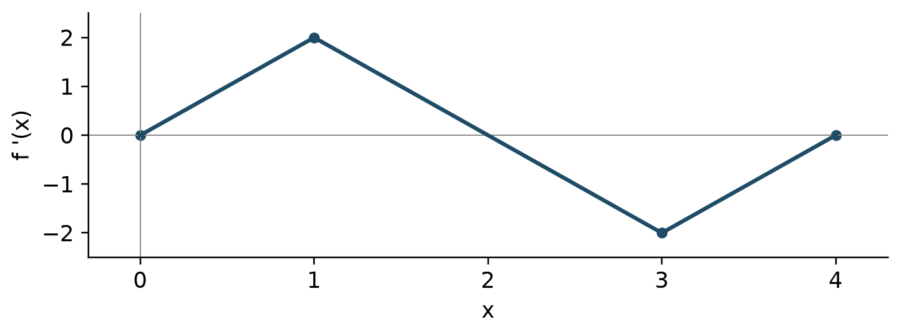

# AP Calculus AB

Original first edition | 2027 preparation | ko

## Unit 1 극한과 연속

함숫값과 극한값을 구별하고, 연속성과 정리의 가정을 근거로 결론을 설명한다.

### 가까워지는 값 읽기

극한은 입력이 한 점에 가까워질 때 출력이 가까워지는 값이다. 점에서의 함숫값이 없거나 극한과 달라도 극한은 존재할 수 있다. 양쪽에서 같은 유한한 값으로 접근해야 양쪽 극한이 존재한다. 그래프의 빈 점과 채운 점을 구별하고, 표는 접근 경향의 근거로 사용한다. 유한한 표만으로 극한이 증명되지는 않는다.

$$\lim_{x\to a^-}f(x)=\lim_{x\to a^+}f(x)=L$$

### 식으로 극한 구하기

먼저 직접 대입한다. $0/0$은 답이 아니라 추가 분석이 필요한 형태이다. 인수분해와 약분은 점 자체가 아닌 주변에서 같은 식을 만든다. 근호가 있으면 켤레식을 곱할 수 있다. 라디안에서 기본 삼각극한을 사용한다. 두 함수 사이에 끼인 함수의 양쪽 경계가 같은 값으로 가면 조임정리를 적용한다.

$$\lim_{x\to0}\frac{\sin x}{x}=1$$

### 연속성과 불연속

연속이려면 점의 함숫값, 양쪽 극한, 두 값의 일치가 모두 필요하다. 구간의 끝에서는 구간 안쪽의 한쪽 연속성을 확인한다. 구멍은 함숫값을 다시 정의해 제거할 수 있지만 점프와 무한 불연속은 한 점의 값을 바꾸어 제거할 수 없다. 유리함수의 약분 전 분모가 정하는 정의역 제한도 기록한다.

$$\lim_{x\to a}f(x)=f(a)$$

### 무한대와 중간값

무한 극한은 수직점근선 주변의 발산을, 무한대에서의 극한은 멀리 떨어진 입력에서의 경향을 설명한다. 유리함수는 최고차항을 비교하되 좌우 부호도 확인한다. 중간값정리는 닫힌 구간에서 연속이고 목표값이 양 끝 함숫값 사이에 있을 때 적용한다. 해의 존재를 보장하지만 유일성까지 보장하지는 않는다.

$$f(a)<N<f(b)\ \Longrightarrow\ f(c)=N\text{ for some }c\in(a,b)$$

### Example

$\lim_{x\to4}(x^2-16)/(x-4)$를 구하라.

$x\ne4$에서 분자는 $(x-4)(x+4)$이다. 따라서 주변의 식은 $x+4$이고 극한은 $8$이다. 원래 식은 $x=4$에서 정의되지 않지만 극한은 존재한다.

0으로 나눠서 극한이 없다고 결론 내리지 않는다.

### Example

$f(x)=x^3+x-5$가 $(1,2)$에서 적어도 하나의 영점을 가짐을 설명하라.

다항함수이므로 $[1,2]$에서 연속이다. $f(1)=-3$, $f(2)=5$이고 $0$은 두 값 사이에 있다. 중간값정리에 따라 $f(c)=0$인 $c\in(1,2)$가 존재한다.

정리 이름만 쓰지 말고 연속성과 부호를 함께 쓴다.

## Unit 2 미분의 정의와 기본 법칙

순간변화율을 극한으로 정의하고, 기본 미분법을 정확히 적용한다.

### 평균에서 순간으로

할선의 기울기는 구간의 평균변화율이고 접선의 기울기는 한 점의 순간변화율이다. 미분계수는 차분몫의 극한으로 정의한다. 표에서 도함수를 추정할 때 점의 양쪽을 쓰는 중앙 차분이 유용하지만, 추정값과 정확한 값을 구별해야 한다.

$$f'(a)=\lim_{h\to0}\frac{f(a+h)-f(a)}{h}$$

### 미분가능성과 연속성

미분가능하면 연속이다. 연속이더라도 뾰족한 점, 첨점, 수직접선에서는 유한한 미분계수가 없을 수 있다. 조각함수의 접합점에서는 먼저 연속성을 확인하고 왼쪽과 오른쪽 기울기를 비교한다. 접선식은 함수의 값과 미분계수 두 정보가 모두 필요하다.

$$y=f(a)+f'(a)(x-a)$$

### 기본 도함수

거듭제곱, 상수배, 합의 미분법을 결합한다. 지수함수와 로그함수, 삼각함수는 별도의 기본 공식을 사용한다. $\ln x$의 실수 정의역은 $x>0$이고 $\ln|x|$의 도함수는 $x\ne0$에서 $1/x$이다. 삼각함수의 미분 공식은 라디안 기준이다.

$$(e^x)'=e^x,\quad(\sin x)'=\cos x,\quad(\cos x)'=-\sin x$$

### 곱과 몫

곱을 미분할 때는 두 항이 생긴다. 몫은 분모의 제곱으로 나누며 분자의 뺄셈 순서를 지킨다. 계산 전에 전개나 약분이 더 쉬운지 판단한다. $\tan x$, $\cot x$, $\sec x$, $\csc x$의 도함수는 사인과 코사인의 몫으로부터 유도할 수 있다.

$$(uv)'=u'v+uv',\qquad\left(\frac{u}{v}\right)'=\frac{u'v-uv'}{v^2}$$

### Example

정의로 $f(x)=x^2$의 $f'(3)$을 구하라.

차분몫은 $((3+h)^2-9)/h=6+h$이다. $h\to0$이면 $f'(3)=6$이다. 접선식은 $y-9=6(x-3)$이다.

차분몫에서 분자 전체를 괄호로 묶는다.

### Example

$f(x)=x^2e^x$를 미분하라.

곱의 법칙으로 $f'(x)=2xe^x+x^2e^x=e^x(x^2+2x)$이다. 두 인수의 도함수를 곱하는 것은 곱의 미분법이 아니다.

곱의 법칙의 두 항을 모두 쓴다.

## Unit 3 합성함수와 음함수 및 역함수 미분

함수의 구조를 읽고 연쇄법칙, 음함수 및 역함수 미분을 선택한다.

### 안쪽과 바깥쪽

연쇄법칙은 바깥 함수의 도함수를 안쪽 값에서 계산하고 안쪽 도함수를 곱한다. 여러 겹이면 각 층의 도함수를 하나씩 곱한다. 곱이나 몫 안에 합성함수가 있으면 필요한 법칙을 함께 적용한다. 먼저 구조를 말로 설명한 뒤 계산하면 누락을 줄일 수 있다.

$$\frac{d}{dx}f(g(x))=f'(g(x))g'(x)$$

### 음함수와 고계도함수

$y$가 $x$에 의존하므로 $y$를 포함한 항의 미분에는 $y'$가 생긴다. 첫 미분 뒤 $y'$를 고립시킨다. 두 번 미분할 때도 $y$의 의존성과 곱의 법칙을 유지한다. 수직접선처럼 기울기 공식의 분모가 0인 경우에는 원래 곡선과 분자도 확인한다.

$$x^2+y^2=r^2\quad\Longrightarrow\quad y'=-\frac{x}{y}\quad(y\ne0)$$

### 역함수의 기울기

역함수의 도함수는 대응하는 원래 점에서의 도함수의 역수이다. 역함수 입력과 원래 함수 입력을 혼동하지 않는다. 국소적으로 역함수가 존재하고 해당 도함수가 0이 아니어야 공식을 사용할 수 있다. 함수와 역함수의 그래프는 $y=x$에 대칭이다.

$$(f^{-1})'(b)=\frac{1}{f'(a)}\quad\text{when }f(a)=b$$

### 역삼각함수와 표기

$\arcsin x$와 $\arctan x$의 도함수 공식을 사용하고 합성되면 연쇄법칙을 적용한다. $\sin^{-1}x$는 이 문맥에서 역함수이지 $1/\sin x$가 아니다. 고계도함수는 첫 도함수를 다시 함수로 보고 미분한다.

$$(\arcsin x)'=\frac{1}{\sqrt{1-x^2}},\quad(\arctan x)'=\frac{1}{1+x^2}$$

### Example

$y=(1+3x^2)^4$의 도함수를 구하라.

바깥의 네제곱을 미분한 뒤 안쪽의 도함수 $6x$를 곱한다. $y'=4(1+3x^2)^3(6x)=24x(1+3x^2)^3$이다.

안쪽 도함수를 생략하지 않는다.

### Example

$f(2)=7$, $f'(2)=5$이고 $g=f^{-1}$이다. $g'(7)$은?

$g(7)=2$이므로 $g'(7)=1/f'(2)=1/5$이다. $f'(7)$의 정보는 필요하지 않다.

역수로 바꾸기 전에 대응점을 찾는다.

## Unit 4 미분의 실제 상황 적용

도함수의 단위와 의미를 설명하고 운동, 관련변화율 및 근사에 적용한다.

### 단위와 운동

도함수의 단위는 출력 단위를 입력 단위로 나눈 것이다. 위치의 도함수는 속도, 속도의 도함수는 가속도이다. 속력은 속도의 절댓값이므로 속도와 가속도의 부호가 같을 때 빨라진다. 움직이는 방향과 빨라지는지는 서로 다른 질문이다.

$$v(t)=s'(t),\quad a(t)=v'(t),\quad\text{speed}=|v(t)|$$

### 관련변화율

그림을 그리고 시간에 따라 변하는 양을 정한다. 먼저 양 사이의 식을 만든 뒤 시간으로 미분하고, 마지막에 주어진 순간의 값을 대입한다. 원뿔 문제에서는 닮음으로 반지름과 높이의 관계를 먼저 줄인다. 길이와 부피의 단위를 끝까지 추적한다.

$$V=\frac{4}{3}\pi r^3\quad\Longrightarrow\quad\frac{dV}{dt}=4\pi r^2\frac{dr}{dt}$$

### 접선으로 근사

알기 쉬운 가까운 점에서 접선을 구해 함숫값을 근사한다. 접선 근사는 국소적인 정보이다. 근사점과 기준점 사이에서 아래로 오목하면 접선은 그래프 위에 있어 과대근사가 되고, 위로 오목하면 과소근사가 된다. 구간의 오목성 조건 없이 오차 방향을 단정하지 않는다.

$$f(a+\Delta x)\approx f(a)+f'(a)\Delta x$$

### 로피탈의 정리

분자의 극한과 분모의 극한이 $0/0$ 또는 무한대 대 무한대 형태인지 먼저 확인한다. 필요한 미분가능성과 분모 도함수 조건 아래에서 분자와 분모를 각각 미분한 비의 극한을 사용할 수 있다. 이는 원래 분수를 미분하는 몫의 법칙과 다르다. 다른 형태는 먼저 대수적으로 바꾼다.

$$\lim\frac{f(x)}{g(x)}=\lim\frac{f'(x)}{g'(x)}\quad\text{when the hypotheses hold}$$

### Example

구의 반지름이 $2$ cm이고 $dr/dt=3$ cm/s이다. 부피 증가율은?

$dV/dt=4\pi r^2(dr/dt)$에 순간값을 대입하면 $4\pi(2)^2(3)=48\pi$ cm$^3$/s이다.

순간 반지름을 미분 전에 상수로 바꾸지 않는다.

### Example

선형근사로 $\sqrt{9.12}$를 추정하라.

$f(9)=3$, $f'(9)=1/6$이므로 $L(9.12)=3+(1/6)(0.12)=3.02$이다. 제곱근 함수는 아래로 오목하므로 이 값은 과대근사이다.

미분계수에 입력 변화량을 곱한다.

## Unit 5 도함수로 함수 분석하기

정리의 가정과 도함수의 부호를 근거로 그래프와 극값을 분석한다.

### 평균값정리와 최대최소정리

평균값정리는 닫힌 구간에서 연속이고 열린 구간에서 미분가능할 때 평균변화율과 같은 순간변화율이 존재함을 보장한다. 최대최소정리는 닫힌 유계구간에서 연속이면 절대최댓값과 절대최솟값을 각각 적어도 하나 갖는다고 말한다. 두 정리가 요구하는 조건을 구별한다.

$$f'(c)=\frac{f(b)-f(a)}{b-a}\quad\text{for some }c\in(a,b)$$

### 증감과 극값

임계수는 정의역 안에서 도함수가 0이거나 존재하지 않는 입력이다. $f'$가 양이면 증가하고 음이면 감소한다. $+$에서 $-$로 부호가 바뀌면 극대, 반대이면 극소이다. 절대극값은 구간의 임계수와 양 끝점의 원래 함숫값을 모두 비교한다. $f'=0$만으로 극값을 단정하지 않는다.

$$f'(x)>0\Rightarrow f\text{ increases},\qquad f'(x)<0\Rightarrow f\text{ decreases}$$

### 오목성과 그래프 연결

$f''>0$이면 $f'$가 증가하며 그래프는 위로 오목하다. 변곡점은 오목성이 실제로 바뀌는 그래프의 점이므로 $f''=0$은 후보 조건일 뿐이다. 둘째 도함수 판정법은 $f'=0$인 점에서 $f''$의 부호를 사용한다. $f''=0$이면 판정 불능이므로 다른 근거를 찾는다. 도함수 그래프를 원래 함수 그래프로 오해하지 않는다.

$$f'(c)=0,\ f''(c)>0\Rightarrow\text{local minimum at }c$$

### 최적화와 음함수 분석

최적화는 목적함수와 제약식을 구별하고 허용 정의역을 먼저 정하는 과정이다. 변수를 하나로 줄인 뒤 임계수와 끝점 또는 경계 거동을 비교한다. 음함수에서도 $y'$와 $y''$의 부호로 접선과 오목성을 분석할 수 있다. 결과가 원래 상황의 길이, 시간, 수량 조건을 만족하는지 확인한다.

$$A(x)=x(P-2x)\quad\text{for a three-sided enclosure of fence length }P$$

### Example

$f(x)=x^3-3x$의 $[-2,2]$에서 절대극값을 구하라.

$f'=3x^2-3=0$에서 $x=-1,1$이다. 끝점과 함께 계산하면 $f(-2)=-2$, $f(-1)=2$, $f(1)=-2$, $f(2)=2$이다. 절대최댓값은 $2$, 절대최솟값은 $-2$이며 각각 두 점에서 달성된다.

끝점과 같은 값을 갖는 모든 위치를 포함한다.

### Example

한 변은 강을 이용하고 세 변에 울타리 $48$ m를 쓴다. 최대 직사각형 넓이는?

강에 수직인 변을 $x$라 하면 다른 변은 $48-2x$이고 $0<x<24$이다. $A'=48-4x=0$에서 $x=12$, 다른 변은 $24$이다. 아래로 오목한 이차함수이므로 최대넓이는 $288$ m$^2$이다.

네 변 전체를 울타리 길이에 넣지 않는다.

## Unit 6 적분과 변화의 누적

정적분을 부호 있는 누적으로 해석하고 미적분의 기본정리와 치환적분을 사용한다.

### 리만합과 수치적분

구간을 나누고 각 폭에 대표 높이를 곱해 더한다. 왼쪽, 오른쪽, 중점 합은 높이를 고르는 방식이 다르다. 사다리꼴은 양 끝 높이의 평균을 사용한다. 구간 폭이 같지 않으면 각 폭을 따로 곱해야 한다. 적분은 부호 있는 넓이이므로 축 아래 기여는 음수이다.

$$\int_a^b f(x)\,dx=\lim_{n\to\infty}\sum_{i=1}^{n} f(a+i\Delta x)\Delta x$$

### 누적함수와 기본정리

연속함수를 고정된 아래끝에서 변수 위끝까지 적분한 누적함수의 도함수는 적분함수이다. 위끝이 합성함수이면 연쇄법칙을 곱한다. 양 끝이 모두 변하면 두 누적함수의 차로 나눈다. 누적함수의 증감은 적분함수의 부호, 오목성은 적분함수의 변화율로 판단한다.

$$\frac{d}{dx}\int_a^{g(x)}f(t)\,dt=f(g(x))g'(x)$$

### 원시함수와 적분의 성질

원시함수는 미분해서 적분함수가 되는 함수이며 부정적분에는 상수 $C$를 쓴다. 정적분은 원시함수의 양 끝 차로 계산한다. 적분 방향을 뒤집으면 부호가 바뀌고 구간을 나누어 더할 수 있다. 대칭구간에서는 홀함수와 짝함수의 성질이 유용하다. 적분 결과를 미분해 확인하는 습관을 들인다.

$$\int_a^b f(x)\,dx=F(b)-F(a)\quad\text{when }F'=f$$

### 치환과 식 정리

안쪽 식과 그 도함수가 함께 있으면 치환적분을 시도한다. 정적분에서 변수를 바꾸면 적분구간도 바꾸거나 마지막에 원래 변수로 돌아온다. 다항식 나눗셈과 완전제곱으로 기본형을 드러낼 수 있다. $1/(1+x^2)$는 역탄젠트, $1/\sqrt{1-x^2}$는 역사인으로 연결된다. 부분적분, 부분분수, 이상적분은 뒤의 BC 확장 범위로 남긴다.

$$\int f(g(x))g'(x)\,dx=F(g(x))+C$$

### Example

$\int_0^1 2x(x^2+1)^3\,dx$를 구하라.

$u=x^2+1$, $du=2x\,dx$이고 구간은 $1$부터 $2$이다. 따라서 $\int_1^2u^3\,du=[u^4/4]_1^2=15/4$이다.

치환한 변수와 원래 변수의 구간을 섞지 않는다.

### Example

$F(x)=\int_1^{x^2}\cos t\,dt$일 때 $F'(x)$는?

기본정리로 적분함수에 위끝을 대입하고 위끝의 도함수를 곱한다. $F'(x)=2x\cos(x^2)$이다.

위끝의 도함수 $2x$를 빠뜨리지 않는다.

## Unit 7 미분방정식

기울기장을 해석하고 변수분리 및 초기조건으로 해를 구한다.

### 미분방정식과 기울기장

미분방정식은 함수와 변화율 사이의 관계를 정한다. 기울기장의 각 짧은 선분은 해당 $(x,y)$에서의 도함수 값을 나타낸다. $y$에만 의존하면 같은 높이에서 기울기가 같고 $x$에만 의존하면 같은 세로줄에서 같다. 하나의 방정식에 해가 무한히 많을 수도 있다.

$$\frac{dy}{dx}=F(x,y)$$

### 해 검증과 평형해

해 후보를 원래 방정식에 대입해 함수와 도함수가 관계를 만족하는지 확인한다. 초기조건도 별도로 확인한다. 평형해는 일정한 함수가 미분방정식을 만족하는 경우이다. 변수분리를 위해 나눈 인수가 0이 될 때 잃어버린 평형해가 있는지 살핀다.

$$y'=k(y-M)\quad\Longrightarrow\quad y=M\text{ is an equilibrium}$$

### 변수분리와 초기조건

$dy/dx=g(x)h(y)$에서 가능한 구간에 한해 $dy/h(y)=g(x)dx$로 분리한다. 양쪽을 적분하고 초기조건으로 상수를 정한다. 제곱근이나 로그로 정리할 때 초기조건에 맞는 가지와 해의 정의구간을 유지한다. 마지막에 미분하여 방정식과 초기조건을 다시 확인한다.

$$\int\frac{1}{h(y)}\,dy=\int g(x)\,dx$$

### 지수성장과 냉각

변화율이 양 자체에 비례하면 지수모형이 된다. 기준값과의 차이에 비례하면 먼저 그 차이를 새 변수로 생각한다. 반감기와 배가시간은 지수식에 조건을 대입해 구한다. 오일러 방법과 로지스틱 모형의 본격적인 계산은 BC 확장 교재에서 다룬다.

$$y'=k(y-M)\quad\Longrightarrow\quad y=M+Ce^{kx}$$

### Example

$y'=2xy$, $y(0)=3$을 풀어라.

$dy/y=2x\,dx$에서 $\ln|y|=x^2+C$이므로 $y=Ae^{x^2}$이다. 초기조건으로 $A=3$이어서 $y=3e^{x^2}$이다. 미분하면 $y'=6xe^{x^2}=2xy$이다.

적분상수를 초기조건에 맞춰 결정한다.

### Example

$T'=-0.2(T-20)$, $T(0)=70$의 해는?

주변온도와의 차이는 $T-20=Ce^{-0.2t}$이다. 초기조건으로 $C=50$이므로 $T=20+50e^{-0.2t}$이다. 시간 경과에 따라 $20$에 접근한다.

초기온도 전체가 아니라 주변온도와의 차이를 지수감소시킨다.

## Unit 8 적분의 응용

적분으로 평균값, 실제 누적량, 넓이와 부피를 구하고 상황에 맞는 단위를 쓴다.

### 평균과 누적량

함수의 평균값은 적분을 구간 길이로 나눈 것이다. 평균변화율과 혼동하지 않는다. 최종량은 초기량에 순변화량을 더한다. 유입과 유출이 있으면 두 변화율의 차이를 적분한다. 최대량을 구할 때는 순변화율이 0인 시각과 끝점을 후보로 비교한다.

$$f_{\mathrm{avg}}=\frac{1}{b-a}\int_a^b f(x)\,dx$$

### 변위와 이동거리

속도를 적분하면 변위이고 속력인 절댓값을 적분하면 총 이동거리이다. 속도가 0인 시각을 찾아 부호가 바뀌는 구간을 나눈다. 위치함수에는 초기위치를 더해야 한다. 속도의 적분값이 0이더라도 움직인 거리는 양수일 수 있다.

$$\Delta s=\int_a^b v(t)\,dt,\qquad D=\int_a^b|v(t)|\,dt$$

### 곡선 사이 넓이

세로 단면에서는 위에서 아래를 빼서 $x$로 적분하고 가로 단면에서는 오른쪽에서 왼쪽을 빼서 $y$로 적분한다. 교점을 모두 찾아 위아래 순서가 바뀌면 나눈다. 부호 있는 적분과 기하학적 넓이를 구별한다. 그림과 식이 같은 영역을 나타내는지 먼저 확인한다.

$$A=\int_a^b(\text{top}-\text{bottom})\,dx$$

### 단면과 회전체의 부피

부피는 단면 넓이를 적분한 것이다. 정사각형은 변의 제곱, 정삼각형은 $\sqrt3/4$ 곱하기 변의 제곱, 지름이 $d$인 반원은 $\pi d^2/8$이다. 원판과 와셔의 반지름은 회전축에서 곡선까지의 거리이다. 다른 수평축이나 수직축으로 회전하면 축과의 거리를 다시 정의한다.

$$V=\int_a^b A(x)\,dx,\qquad V=\pi\int_a^b(R^2-r^2)\,dx$$

### Example

$v(t)=t-2$, $0\le t\le4$에서 변위와 총 이동거리는?

변위는 $\int_0^4(t-2)\,dt=0$이다. $t=2$에서 부호가 바뀌므로 이동거리는 $-\int_0^2(t-2)\,dt+\int_2^4(t-2)\,dt=4$이다.

거리에서는 반대 방향 이동이 상쇄되지 않는다.

### Example

$y=x$와 $y=x^2$ 사이 $0\le x\le1$의 영역을 $x$축 둘레로 돌린 부피는?

바깥 반지름은 $x$, 안쪽 반지름은 $x^2$이므로 $V=\pi\int_0^1(x^2-x^4)\,dx=\pi(1/3-1/5)=2\pi/15$이다.

반지름 차의 제곱이 아니라 제곱의 차를 적분한다.

## Assessment questions

### D01

$x^2-5x+6=0$의 큰 해는?

- A. $3$
- B. $6$
- C. $2$
- D. $5$

### D02

$x\ne4$에서 $(x^2-16)/(x-4)$와 같은 식은?

- A. $x + 4$
- B. $x^{2} + 4$
- C. $x - 4$
- D. $4$

### D03

$\sin(\pi/6)$의 값은?

- A. $0$
- B. $\frac{1}{2}$
- C. $\frac{\sqrt{3}}{2}$
- D. $1$

### D04

$\ln(e^3)$의 값은?

- A. $0$
- B. $3$
- C. $e^{3}$
- D. $1$

### D05

$f(x)=x^2+1$, $g(x)=2x-3$일 때 $f(g(2))$는?

- A. $7$
- B. $10$
- C. $1$
- D. $2$

### D06

$(1,3)$과 $(5,11)$을 지나는 직선의 기울기는?

- A. $2$
- B. $\frac{1}{2}$
- C. $8$
- D. $4$

### D07

$\ln(x-2)$의 실수 정의역은?

- A. $x\ge2$
- B. 모든 실수
- C.  $x>2$
- D. $x<2$

### D08

$f(x)=3x+5$일 때 $f^{-1}(11)$은?

- A. $2$
- B. $\frac{16}{3}$
- C. $38$
- D. $\frac{1}{11}$

### D09

$x>0$에서 $x^{3/2}/x^{1/2}$는?

- A. $x$
- B. $\sqrt{x}$
- C. $1$
- D. $x^{2}$

### D10

$\sin^2x+\cos^2x$는?

- A. $1$
- B. $\sin{\left(2 x \right)}$
- C. $2$
- D. $0$

### D11

$x^2-6x+11$의 최솟값은?

- A. $11$
- B. $3$
- C. $2$
- D. $-6$

### D12

$|x-2|=5$의 두 해의 합은?

- A. $10$
- B. $-3$
- C. $4$
- D. $7$

### U1-M01

$\lim_{x\to3}(x^2-9)/(x-3)$는?

- A. $3$
- B. $0$
- C. $6$
- D. $9$

### U1-M02

$x<0$에서 $f(x)=2+x$, $x\ge0$에서 $f(x)=5-x$이다. $x=0$에서 양쪽 극한은?

- A. $5$
- B. $7/2$
- C. 존재하지 않는다
- D. $2$

### U1-M03

$x<2$에서 $f(x)=kx+1$, $x\ge2$에서 $f(x)=x^2+5$이다. 연속이 되게 하는 $k$는?

- A. $4$
- B. $9$
- C. $2$
- D. $5$

### U1-M04

$\lim_{x\to0}x^2\sin(1/x)$는?

- A. $2$
- B. $1$
- C. $0$
- D. $-1$

### U1-M05

$\lim_{x\to\infty}(3x^2-x)/(2x^2+7)$는?

- A. $\frac{2}{3}$
- B. $3$
- C. $0$
- D. $\frac{3}{2}$

### U1-M06

$f$가 $[0,4]$에서 연속이고 $f(0)=-2$, $f(4)=6$이다. 반드시 참인 것은?

- A. $f(c)=1$인 $c\in(0,4)$가 있다
- B. 영점은 정확히 하나이다
- C. $f$는 증가한다
- D. $f(2)=2$

### U2-M01

$\lim_{h\to0}((2+h)^3-8)/h$는?

- A. $4$
- B. $12$
- C. $6$
- D. $8$

### U2-M02

$f(x)=x^2\sin x$일 때 $f\prime(\pi/2)$는?

- A. $0$
- B. $2$
- C. $\pi$
- D. $\frac{\pi^{2}}{4}$

### U2-M03

$f(x)=(x^2+1)/(x+1)$일 때 $f\prime(1)$은?

- A. $1$
- B. $\frac{1}{2}$
- C. $2$
- D. $0$

### U2-M04

$f(x)=\tan x$일 때 $f\prime(\pi/4)$는?

- A. $\sqrt{2}$
- B. $1$
- C. $2$
- D. $0$

### U2-M05

$f(x)=|x-2|$의 $x=2$에서의 성질은?

- A. 연속이지만 미분가능하지 않다
- B. 미분계수는 $0$이다
- C. 연속이고 미분가능하다
- D. 불연속이다

### U2-M06

표의 $x=1.8,2,2.2$에서 $f(x)=4.1,4.8,5.7$이다. 양옆 점을 쓰는 $f\prime(2)$의 추정값은?

- A. $4$
- B. $0.8$
- C. $8$
- D. $2$

### U3-M01

$f(x)=(2x^3+1)^4$일 때 $f\prime(1)$은?

- A. $108$
- B. $648$
- C. $216$
- D. $72$

### U3-M02

$x^2+xy+y^2=7$에서 점 $(1,2)$의 $dy/dx$는?

- A. $- \frac{5}{4}$
- B. $- \frac{1}{2}$
- C. $\frac{4}{5}$
- D. $- \frac{4}{5}$

### U3-M03

$f(3)=8$, $f\prime(3)=4$이고 $f$의 국소 역함수 $g$가 있다. $g\prime(8)$은?

- A. $3$
- B. $4$
- C. $\frac{1}{4}$
- D. $\frac{1}{8}$

### U3-M04

$f(x)=\arctan(3x)$일 때 $f\prime(0)$은?

- A. $3$
- B. $\frac{1}{3}$
- C. $0$
- D. $1$

### U3-M05

$f(x)=\sin(2x)$일 때 $f^{\prime\prime}(\pi/4)$는?

- A. $-2$
- B. $4$
- C. $0$
- D. $-4$

### U3-M06

$g$가 $f(x)=\ln x$의 역함수이다. $g\prime(\ln5)$는?

- A. $5$
- B. $\frac{1}{5}$
- C. $\log{\left(5 \right)}$
- D. $1$

### U4-M01

한 입자의 속도가 $v(t)=3t^2-12t+9$이다. $t=3/2$에서 입자는?

- A. 음의 방향으로 움직이며 느려진다
- B. 정지해 있다
- C. 양의 방향으로 움직이며 빨라진다
- D. 음의 방향으로 움직이며 빨라진다

### U4-M02

구의 반지름이 $3$ cm일 때 $dr/dt=2$ cm/s이다. $dV/dt$는 몇 cm$^3$/s인가?

- A. $18 \pi$
- B. $24 \pi$
- C. $36 \pi$
- D. $72 \pi$

### U4-M03

$x=16$에서의 선형근사로 $\sqrt{16.2}$를 추정하면?

- A. $4$
- B. $\frac{41}{10}$
- C. $\frac{161}{40}$
- D. $\frac{81}{20}$

### U4-M04

$\lim_{x\to0}(e^{2x}-1)/x$는?

- A. $1$
- B. $0$
- C. $4$
- D. $2$

### U4-M05

$W(t)$가 탱크의 물의 양(L), $t$가 시간(h)이다. $W\prime(3)=-4$의 의미는?

- A. 감소율이 시간당 $4$ L씩 더 커진다
- B. $3$시간일 때 물의 양이 시간당 $4$ L의 비율로 감소한다
- C. 첫 $3$시간 동안 물이 $4$ L 줄었다
- D. $3$시간일 때 물이 $4$ L이다

### U4-M06

길이 $10$ m 사다리의 바닥이 벽에서 $6$ m 떨어져 있고 바깥으로 $2$ m/s로 움직인다. 윗부분의 높이 변화율은?

- A. $\frac{3}{2}$
- B. $-2$
- C. $- \frac{8}{3}$
- D. $- \frac{3}{2}$

### U5-M01

$f(x)=x^2$의 $[1,5]$에서 평균값정리의 $c$는?

- A. $4$
- B. $2$
- C. $3$
- D. $6$

### U5-M02

$f(x)=x^3-3x$의 $[-2,2]$에서 절대최댓값은?

- A. $-2$
- B. $0$
- C. $2$
- D. $6$

### U5-M03

$f(x)=x^3$의 $x=0$에 대한 설명으로 옳은 것은?

- A. 극소점이다
- B. 임계수가 아니다
- C. 변곡점이며 극대나 극소는 아니다
- D. 극대점이다

### U5-M04

$f\prime(x)=(x-1)(x-3)$일 때 $f$가 증가하는 구간은?

- A. $(1,3)$
- B.  $(-\infty,1)$과 $(3,\infty)$
- C. 모든 실수
- D. $(-\infty,3)$

### U5-M05

$f^{\prime\prime}(x)=6x-12$이고 $f$가 모든 실수에서 두 번 미분가능하다. 변곡점의 $x$좌표는?

- A. $6$
- B. $2$
- C. $12$
- D. $0$

### U5-M06

둘레가 $40$ m인 직사각형의 가능한 최대넓이는 몇 m$^2$인가?

- A. $80$
- B. $200$
- C. $400$
- D. $100$

### U6-M01

$\int_0^2(3x^2+1)\,dx$는?

- A. $14$
- B. $8$
- C. $6$
- D. $10$

### U6-M02

$F(x)=\int_0^{x^2}\sqrt{1+t}\,dt$일 때 $F\prime(2)$는?

- A. $4 \sqrt{5}$
- B. $2 \sqrt{5}$
- C. $4 \sqrt{3}$
- D. $\sqrt{5}$

### U6-M03

표의 $t=0,1,3$에서 $r(t)=2,4,8$이다. 두 사다리꼴로 $\int_0^3r(t)\,dt$를 추정하면?

- A. $14$
- B. $18$
- C. $12$
- D. $15$

### U6-M04

$\int_0^1 6x(1+3x^2)^2\,dx$는?

- A. $63$
- B. $7$
- C. $21$
- D. $16$

### U6-M05

$x>0$에서 $(x^2+1)/x$의 한 원시함수는?

- A. $2 x - \frac{1}{x^{2}}$
- B. $\log{\left(x^{2} + 1 \right)}$
- C. $x^{2} + \log{\left(x \right)}$
- D. $\frac{x^{2}}{2} + \log{\left(x \right)}$

### U6-M06

그림은 선분으로 연결된 $f$의 그래프이다. $F(x)=\int_0^x f(t)\,dt$일 때 $F(3)$은?

- A. $6$
- B. $4$
- C. $3$
- D. $2$

### U7-M01

$y\prime=3y$, $y(0)=2$일 때 $y(\ln2)$는?

- A. $8$
- B. $16$
- C. $4$
- D. $6$

### U7-M02

$y\prime=x-y$가 주는 점 $(1,3)$의 기울기는?

- A. $-2$
- B. $-4$
- C. $4$
- D. $2$

### U7-M03

$y\prime=x/y$, $y(0)=2$인 해의 $y(1)$은?

- A. $\sqrt{3}$
- B. $- \sqrt{5}$
- C. $5$
- D. $\sqrt{5}$

### U7-M04

$y\prime=-2(y-7)$의 평형해는?

- A. $-7$
- B. $7$
- C. $0$
- D. $2$

### U7-M05

$y=Ce^{-2x}$가 모든 상수 $C$에 대해 만족하는 방정식은?

- A. $y\prime=y^2$
- B. $y\prime=2y$
- C. $y\prime=-2y$
- D. $y\prime=-2x$

### U7-M06

$T\prime=-\tfrac12(T-20)$, $T(0)=60$이면 $T(2)$는?

- A. $\frac{40}{e} + 20$
- B. $\frac{40}{e}$
- C. $20 + \frac{60}{e}$
- D. $\frac{60}{e}$

### U8-M01

$f(x)=x^2$의 $[0,3]$에서 평균값은?

- A. $9$
- B. $6$
- C. $\frac{9}{2}$
- D. $3$

### U8-M02

$v(t)=t-1$ m/s인 입자가 $0\le t\le3$에서 이동한 총 거리는 몇 m인가?

- A. $\frac{3}{2}$
- B. $3$
- C. $2$
- D. $\frac{5}{2}$

### U8-M03

$y=x$와 $y=x^2$ 사이 $0\le x\le1$의 넓이는?

- A. $\frac{2}{3}$
- B. $\frac{1}{3}$
- C. $\frac{1}{6}$
- D. $\frac{1}{2}$

### U8-M04

$y=\sqrt x$, $x$축 및 $x=4$가 둘러싼 영역을 $x$축 둘레로 회전한 부피는?

- A. $4 \pi$
- B. $\frac{32 \pi}{3}$
- C. $8 \pi$
- D. $16 \pi$

### U8-M05

$y=x$와 $y=x^2$ 사이 영역을 밑면으로 하고 $x$축에 수직인 단면이 정사각형이다. 부피는?

- A. $\frac{1}{15}$
- B. $\frac{1}{30}$
- C. $\frac{1}{6}$
- D. $\frac{\pi}{30}$

### U8-M06

$x=y^2$와 $x=2y$가 둘러싼 넓이는?

- A. $\frac{8}{3}$
- B. $4$
- C. $\frac{4}{3}$
- D. $\frac{2}{3}$

### U1-F01

함수 $f$는 $x<1$에서 $x^2+a$, $x=1$에서 $b$, $x>1$에서 $3x-1$로 정의한다.

(a) $x=1$에서 좌극한과 우극한을 구하라.
(b) $f$가 모든 실수에서 연속이 되게 하는 $a,b$를 구하라.
(c) (b)의 값을 사용하라. $f(c)=3$인 $c\in(0,2)$의 존재를 정리로 설명하고 한 값을 구하라.

### U1-F02

그림의 그래프는 두 선분 $(-1,0)$에서 $(1,2)$, $(1,2)$에서 $(3,0)$으로 이어지지만 $(1,2)$는 빈 점이고 실제 함숫값은 $g(1)=4$이다.

(a) $x=1$에서 양쪽 극한과 함숫값을 각각 구하라.
(b) 한 점의 값만 바꾸어 $x=1$에서 연속이 되게 하라.
(c) 원래 함수에 대해 $g(0)=1$, $g(1)=4$이다. 중간값정리로 $[0,1]$에서 값 $3$을 가진다고 할 수 있는가? 실제로 그런 점이 있는가?

### U2-F01

$f(x)=x^3-2x$이다.

(a) 차분몫의 극한을 직접 전개하여 $f\prime(-1)$을 구하라.
(b) $x=-1$에서 접선식을 구하라.
(c) $f^{\prime\prime}(-1)$을 구하고 이것이 접선의 기울기와 같은 정보인지 설명하라.

### U2-F02

$P(t)$는 온실 식물의 높이(cm)이며 $t$의 단위는 주이다. $P$는 미분가능하다. 표를 사용하라.

| t | P(t) |
| --- | --- |
| 0 | 2 |
| 1 | 3.5 |
| 2 | 6 |
| 3 | 10 |

(a) $t=1,3$의 값을 사용하여 $P\prime(2)$를 추정하고 단위를 쓰라.
(b) $[0,3]$에서 높이의 평균변화율을 구하라.
(c) (a)의 추정 기울기로 $P(2.2)$를 근사하라.

### U3-F01

원 $x^2+y^2=25$ 위의 점 $(3,4)$를 생각하라.

(a) $dy/dx$를 $x,y$로 나타내고 해당 점에서 값을 구하라.
(b) 해당 점에서 접선식을 구하라.
(c) $d^2y/dx^2$의 해당 점에서의 값을 구하라.

### U3-F02

$f(x)=x^3+x$이고 $g=f^{-1}$이다.

(a) 역함수가 존재하는 이유를 설명하고 $g(10)$을 구하라.
(b) $g\prime(10)$을 구하라.
(c) $H(x)=g(5x)$일 때 $H\prime(2)$를 구하라.

### U4-F01

입자의 위치는 $s(t)=t^3-6t^2+9t$ m이고 $0\le t\le4$에서 $t$의 단위는 s이다.

(a) 속도와 가속도의 식을 구하라.
(b) $t=1.5$에서 움직이는 방향과 빨라지는지를 근거와 함께 설명하라.
(c) $t=1.5$에서의 선형근사로 $s(1.6)$을 구하라.

### U4-F02

꼭짓점이 아래인 원뿔 탱크는 높이 $8$ cm, 윗반지름 $4$ cm이다. 물이 일정하게 $3\pi$ cm$^3$/s씩 들어온다. 한 순간 물의 높이는 $2$ cm이다.

(a) 물의 부피 $V$를 물의 높이 $h$만으로 나타내라.
(b) 해당 순간 $dh/dt$를 구하라.
(c) $0.1$초 뒤의 물 높이를 선형근사하라. 실제 높이에 비해 과대인지 근거를 쓰라.

### U5-F01

$f(x)=x^3-6x^2+9x+1$을 $[0,4]$에서 분석하라.

(a) 증가와 감소 구간 및 내부의 극대와 극소 위치를 근거와 함께 구하라.
(b) 절대최댓값과 절대최솟값 및 모든 달성 위치를 구하라.
(c) 변곡점을 구하고 오목성 변화를 설명하라.

### U5-F02

한 변이 $18$ cm인 정사각형 종이의 네 모서리에서 한 변 $x$ cm인 정사각형을 잘라내고 접어 뚜껑 없는 상자를 만든다.

(a) 부피함수와 물리적으로 가능한 $x$의 범위를 쓰라.
(b) 최대 부피를 만드는 $x$와 그 부피를 근거와 함께 구하라.
(c) 제작 장비 때문에 $0<x\le2$로 제한되면 최대 부피는?

### U6-F01

그림은 $f$의 그래프이다. $F(x)=1+\int_0^x f(t)\,dt$로 정의하고 $0\le x\le4$로 제한한다.

(a) $F(3)$과 $F(4)$를 구하라.
(b) $F\prime(2)$와 $F^{\prime\prime}(2)$를 구하라.
(c) $F$의 절대최댓값과 그 위치를 근거와 함께 구하라.

### U6-F02

$r(t)$는 물의 유입률(L/min)이다. 처음에 물이 $20$ L 있다. 표에 없는 시간에도 $r$는 연속이며, 구간 전체에서 물은 유입만 된다.

| t | r(t) |
| --- | --- |
| 0 | 3 |
| 2 | 5 |
| 5 | 4 |
| 6 | 7 |

(a) 표의 세 구간에 대해 왼쪽 리만합으로 $\int_0^6r(t)\,dt$를 추정하라.
(b) 같은 구간들에 사다리꼴합을 사용하라.
(c) (b)로 $t=6$의 물의 양과 $[0,6]$에서 평균유입률을 추정하라.

### U7-F01

$y\prime=x(y-1)$이고 $y(0)=3$이다.

(a) 기울기가 0인 점들의 집합을 설명하고 초기점의 접선 기울기를 구하라.
(b) 초기조건을 만족하는 해를 구하라.
(c) 이 해의 오목성을 모든 실수에서 설명하라.

### U7-F02

물체의 온도는 $T\prime=-k(T-18)$, $k>0$을 만족한다. $T(0)=82$, $T(10)=50$이며 시간은 분, 온도는 섭씨이다.

(a) $T$를 $k,t$로 나타내라.
(b) $k$를 정확히 구하라.
(c) 온도가 $26$이 되는 시각을 구하라.

### U8-F01

$v(t)=(t-1)(t-3)$ m/s, $s(0)=2$ m이고 $0\le t\le4$이다.

(a) $s(4)$를 구하라.
(b) 총 이동거리를 구하라.
(c) $s$의 절대최댓값 및 모든 달성 시각을 구하라.

### U8-F02

$R$은 $y=x$와 $y=x^2$로 둘러싸인 유계영역이다.

(a) 교점과 영역의 넓이를 구하라.
(b) $R$을 $x$축 둘레로 회전한 부피를 구하라.
(c) $R$을 직선 $y=2$ 둘레로 회전한 부피를 구하라.

### E01

$\lim_{x\to4}(\sqrt{x+5}-3)/(x-4)$를 구하라.

- A. $\frac{1}{3}$
- B. $\frac{1}{6}$
- C. $0$
- D. $3$

### E02

$f(x)=e^x+x^{-2}$일 때 $f\prime(1)$은?

- A. $e$
- B. $-2 + e$
- C. $-1 + e$
- D. $2 + e$

### E03

$xy+y^2=6$ 위의 점 $(1,2)$에서 접선 기울기는?

- A. $- \frac{2}{5}$
- B. $- \frac{5}{2}$
- C. $- \frac{1}{2}$
- D. $\frac{2}{5}$

### E04

$T(t)$는 섭씨 온도이고 $t$는 분이다. $T\prime(5)=3.2$는 무엇을 뜻하는가?

- A. $5$분 동안 $3.2$도 올랐다
- B. 온도 증가율이 분당 $3.2$씩 증가한다
- C. $5$분일 때 온도가 $3.2$도이다
- D. $5$분일 때 온도가 분당 $3.2$도씩 오른다

### E05

$f(x)=\ln x$의 $[1,e^2]$에서 평균값정리를 만족하는 $c$는?

- A. $\frac{2}{-1 + e^{2}}$
- B. $\frac{1}{2} + \frac{e^{2}}{2}$
- C. $e$
- D. $- \frac{1}{2} + \frac{e^{2}}{2}$

### E06

$\int_{-1}^1(3x^2+2x)\,dx$는?

- A. $4$
- B. $0$
- C. $2$
- D. $6$

### E07

$y\prime=2y$, $y(0)=5$일 때 $y(1)$은?

- A. $7$
- B. $5 e^{2}$
- C. $10$
- D. $5 e$

### E08

$y=2x-x^2$와 $x$축으로 둘러싸인 넓이는?

- A. $\frac{2}{3}$
- B. $\frac{8}{3}$
- C. $2$
- D. $\frac{4}{3}$

### E09

$\lim_{x\to2}1/(x-2)^2$는?

- A. $0$
- B. $\infty$
- C. $-\infty$
- D. $1$

### E10

$x=1,2,3$에서 $f(x)=5,8,15$이다. $x=1,3$으로 $f\prime(2)$를 추정하면?

- A. $10$
- B. $3$
- C. $5$
- D. $7$

### E11

$f(x)=\arcsin(x/2)$일 때 $f\prime(1)$은?

- A. $\frac{2 \sqrt{3}}{3}$
- B. $\sqrt{3}$
- C. $\frac{1}{2}$
- D. $\frac{\sqrt{3}}{3}$

### E12

$\lim_{x\to0}\ln(1+3x)/\sin(2x)$는?

- A. $3$
- B. $0$
- C. $\frac{3}{2}$
- D. $\frac{2}{3}$

### E13

그림은 $f\prime$의 그래프이다. $f$가 위로 오목한 열린 구간은?

- A. $(1,3)$
- B. $(0,2)$
- C. $(2,4)$
- D. $(0,1)$과 $(3,4)$

### E14

$\lim_{n\to\infty}\sum_{i=1}^n(2/n)(1+2i/n)^2$는?

- A. $9$
- B. $\frac{8}{3}$
- C. $\frac{26}{3}$
- D. $\frac{13}{3}$

### E15

$y\prime=x(y+4)$를 변수분리하며 $y+4$로 나누었다. 따로 확인해야 하는 상수해는?

- A. $0$
- B. $-4$
- C. $- x$
- D. $4$

### E16

$\sin x$의 $[0,\pi]$에서 평균값은?

- A. $1$
- B. $2$
- C. $\frac{\pi}{2}$
- D. $\frac{2}{\pi}$

### E17

$p(x)=x^3+2x-1$이다. $(0,1)$에 영점이 있다는 올바른 근거는?

- A. 연속이고 $p(0)=-1<0<2=p(1)$이므로 중간값정리
- B. $p(0)+p(1)>0$이기 때문이다
- C. 끝점의 부호만 반대이면 연속성은 필요 없다
- D. 모든 삼차식의 영점은 $(0,1)$에 있다

### E18

$f(x)=x\sin x$일 때 $f\prime(\pi)$는?

- A. $\pi$
- B. $-1$
- C. $0$
- D. $- \pi$

### E19

반지름이 고정된 $2$ m 원통에서 물 높이가 $3$ m/min씩 증가한다. 부피 변화율은 몇 m$^3$/min인가?

- A. $24 \pi$
- B. $12 \pi$
- C. $4 \pi$
- D. $6 \pi$

### E20

$f(x)=x^4-4x^2$의 $[-2,2]$에서 절대최솟값은?

- A. $-4$
- B. $4$
- C. $0$
- D. $-8$

### E21

$\int_0^1 1/(1+x^2)\,dx$는?

- A. $\frac{\pi}{4}$
- B. $\frac{1}{2}$
- C. $\frac{\pi}{2}$
- D. $\log{\left(2 \right)}$

### E22

$x=\sqrt y$, $y$축, $y=4$가 둘러싼 영역을 $y$축 둘레로 회전한 부피는?

- A. $8 \pi$
- B. $16 \pi$
- C. $\frac{32 \pi}{3}$
- D. $4 \pi$

### E23

$\lim_{x\to0}\sin(5x)/(3x)$는?

- A. $\frac{3}{5}$
- B. $1$
- C. $\frac{5}{3}$
- D. $0$

### E24

$x<1$에서는 $f(x)=ax+b$, $x\ge1$에서는 $f(x)=x^2$이다. $x=1$에서 미분가능할 때 $b$는?

- A. $1$
- B. $0$
- C. $2$
- D. $-1$

### E25

$y=\sqrt{9-x^2}$의 $-3<x<3$에서 오목성은?

- A. 구간 전체에서 위로 오목하다
- B. $x=0$에서 오목성이 바뀐다
- C. 선형이다
- D. 구간 전체에서 아래로 오목하다

### E26

$1/(x^2-2x+5)$의 한 원시함수는?

- A. $\operatorname{atan}{\left(x - 1 \right)}$
- B. $\log{\left(x^{2} - 2 x + 5 \right)}$
- C. $2 \operatorname{atan}{\left(\frac{x}{2} - \frac{1}{2} \right)}$
- D. $\frac{\operatorname{atan}{\left(\frac{x}{2} - \frac{1}{2} \right)}}{2}$

### E27

$0\le x\le2$에서 단면이 지름 $2-x$인 반원이다. 부피는?

- A. $\frac{4 \pi}{3}$
- B. $\frac{2 \pi}{3}$
- C. $\frac{\pi}{3}$
- D. $\frac{8}{3}$

### E28

$f\prime(x)=x^2(x+1)$이다. 극값에 대한 옳은 설명은?

- A. $x=-1$에서 극소이고 $x=0$에서는 극값이 없다
- B. $x=-1$에서 극대이다
- C. 두 점 모두 극소이다
- D. $x=0$에서만 극대이다

### E29

$F(x)=\int_x^{2x}\cos(t^2)\,dt$일 때 $F\prime(0)$은?

- A. $0$
- B. $1$
- C. $2$
- D. $-1$

### E30

$p(x)=x^3+x-4$의 $[1,2]$ 안의 영점을 세 자리 소수로 구하라.

- A. $1.812$
- B. $1.379$
- C. $1.587$
- D. $1.213$

### E31

$f(x)=x^2e^x$일 때 $f\prime(0.7)$을 구하라.

- A. $0.987$
- B. $3.806$
- C. $1.904$
- D. $2.819$

### E32

$f(x)=x+e^x$, $g=f^{-1}$이다. $b=1.2+e^{1.2}$일 때 $g\prime(b)$는?

- A. $0.432$
- B. $0.231$
- C. $4.32$
- D. $0.301$

### E33

$v(t)=\sin(t^2)+0.2t$ m/s이다. $t=1.4$에서 가속도는 몇 m/s$^2$인가?

- A. $0.862$
- B. $-0.862$
- C. $-0.379$
- D. $1.205$

### E34

$f(x)=x^2+e^{-x}$가 $[0,2]$에서 절대최소를 갖는 $x$는?

- A. $0.693$
- B. $1.0$
- C. $1.256$
- D. $0.352$

### E35

$f(x)=2\sin x-x^2/2$의 $[0,\pi]$에서 절대최댓값은?

- A. $1.03$
- B. $2.0$
- C. $0.816$
- D. $1.184$

### E36

$\int_0^1e^{-x^2}\,dx$를 구하라.

- A. $0.842$
- B. $0.632$
- C. $1.128$
- D. $0.747$

### E37

$F(x)=\int_0^{\ln x}e^{-t^2}\,dt$일 때 $F\prime(2)$는?

- A. $0.24$
- B. $0.309$
- C. $0.619$
- D. $0.347$

### E38

표의 세 구간에 사다리꼴합을 적용해 $\int_0^2 f(x)\,dx$를 추정하라.

| x | f(x) |
| --- | --- |
| 0 | 1 |
| 0.5 | 1.6 |
| 1.5 | 2.1 |
| 2 | 2.4 |

- A. $3.45$
- B. $4.1$
- C. $3.8$
- D. $3.625$

### E39

$y\prime=0.4(10-y)$, $y(0)=2$이다. 처음 $y=8$이 되는 시간은?

- A. $3.466$
- B. $1.733$
- C. $2.5$
- D. $5.198$

### E40

$y=e^{-x}$, $y=x/2$, $y$축으로 둘러싸인 넓이는?

- A. $0.574$
- B. $0.853$
- C. $0.608$
- D. $0.392$

### E41

$v(t)=\cos t-0.2$ m/s인 입자의 $[0,4]$에서 총 이동거리는 몇 m인가?

- A. $3.517$
- B. $2.969$
- C. $0.757$
- D. $1.557$

### E42

$T(t)=20+80e^{-0.3t}$일 때 $T\prime(4)$는?

- A. $44.096$
- B. $-7.229$
- C. $-24.096$
- D. $7.229$

### EF01

탱크에 처음 $40$ L의 물이 있다. $0\le t\le4$분에서 유입률은 $R(t)=12+3\sin(t^2/4)$ L/min, 유출률은 $D(t)=8+t$ L/min이다.

(a) $t=4$에서 물의 양을 소수 셋째 자리까지 구하라.
(b) $[0,4]$에서 물의 양이 최대가 되는 시각을 근거와 함께 구하라.
(c) $t=2$에서 물의 양의 증가율이 커지고 있는지 설명하라.

### EF02

$f(x)=e^{-x^2}+x/4$이고 $F(x)=\int_0^x f(t)\,dt$이다. $0\le x\le2$이다.

(a) $F(2)$와 $f$의 구간 평균값을 구하라.
(b) $f$의 절대최댓값을 구하고 후보 비교를 제시하라.
(c) $F$가 구간 전체에서 증가하는지 근거와 함께 설명하라.

### EF03

그림은 연속함수 $f$의 그래프이며 $G(x)=\int_0^x f(t)\,dt$이다. 정의역은 $[0,4]$이다.

(a) $G(4)$와 $G\prime(2)$를 구하라.
(b) $G$의 절대최대와 달성 위치를 근거와 함께 구하라.
(c) $G$의 변곡점 입력을 모두 찾고, 왜 $x=1$도 포함되는지 설명하라.

### EF04

$y\prime=2x(y+2)$이고 $y(0)=1$이다.

(a) 초기점에서의 접선을 구하고 그 접선으로 $y(0.1)$을 추정하라.
(b) 변수분리로 명시적 해를 구하라.
(c) (a)의 근사가 과대인지 과소인지 둘째 도함수로 설명하라.

### EF05

$R$은 $y=4-x^2$와 $x$축으로 둘러싸인 영역이다.

(a) $R$의 넓이를 구하라.
(b) $R$을 $x$축 둘레로 회전한 부피를 구하라.
(c) 밑면이 $R$이고 $x$축에 수직인 단면이 정삼각형인 입체의 부피를 구하라.

### EF06

$x<1$에서 $f(x)=ax+b$이고 $x\ge1$에서 $f(x)=x^2+1$이다. 함수가 $x=1$에서 미분가능하도록 정한다.

(a) $a,b$를 구하고 두 조건을 각각 제시하라.
(b) $[0,2]$에서 평균값정리를 적용할 수 있는 이유를 쓰고, 정리를 만족하는 $c\in(0,2)$를 구하라.
(c) $f$의 $[0,2]$에서 평균값을 구하라.
